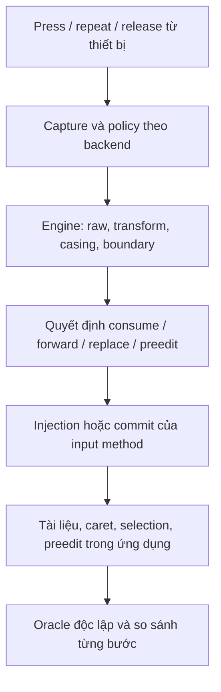

# Audit cơ chế gõ tiếng Việt và playbook kiểm thử cho agent

Ngày audit: **2026-11-03**. Đối tượng: **working tree**, nền HEAD `26fda2379ab538f18af99c3672da855a24c6c818`, bao gồm thay đổi chưa commit. Đây là audit chuyên biệt luồng gõ, không thay thế audit bảo mật toàn dự án.

> **Bàn giao nhanh:** đọc mục 1, 3, 4, 7 và 9 trước khi chạy. Chỉ tier H được chạy headless. Tier D cần người dùng cho phép và desktop dùng một lần. Các adapter/enumerator ở mục 5–6 là **đặc tả cần triển khai**, không phải công cụ đã tồn tại. Không sửa production chỉ để biến test đỏ thành xanh.

## 1. Phạm vi, bằng chứng và an toàn

Không thể vét cạn mọi lịch sử sử dụng vô hạn, mọi scheduler và mọi ứng dụng. Có thể vét cạn **tập sự kiện hữu hạn với độ sâu công bố**, kết hợp corpus ngữ pháp, mô hình trạng thái, fault injection và kiểm thử desktop thật. Báo cáo phải ghi mẫu số và ô chưa chạy; không kết luận “hết mọi lỗi”.

Mức bằng chứng:

| Nhãn | Ý nghĩa |
|---|---|
| `STATIC` | Đọc nhánh mã; chưa xác nhận hành vi bằng thực thi |
| `MODEL_REPRO` | Tái hiện engine + mô hình tài liệu độc lập; chưa chứng minh capture/inject thật |
| `HANDLER_REPRO` | Gọi API/handler thật với dependency giả; chưa chứng minh GUI |
| `DESKTOP_REPRO` | Phím đi qua daemon thật; nội dung đọc từ ứng dụng thật |

Audit này có bằng chứng headless engine và phân tích tĩnh. **Không chạy test bàn phím/clipboard trên desktop thật.** Artifact khảo sát cục bộ nằm trong `target/fresh-audit-20261103/` (`probe.rs`, `confirm.rs`, `parser.rs`, log default/rollback); `target/` không được version control, nên các trace quan trọng được chép lại bên dưới. Các probe này không phải runner regression đã tích hợp.

Rào chắn bắt buộc:

- Không `sudo cargo test`, `cargo test` không chọn target, `make test`, hay test live chỉ vì thấy tên “test”. `daemon/tests/live_remote_bypass.rs` không được gate đầy đủ; một số test cũ có thể chạm thiết bị khi chạy root.
- Bỏ `DISPLAY` không cô lập `/dev/uinput`. Opt-in không tạo sandbox. Dùng VM/session dùng một lần, tài khoản/profile giả, không có dữ liệu cá nhân.
- Không chạy `scripts/setup-test-vm.sh` tự động: script provisioning có thao tác cài đặt/checkout và giả định cũ. Không chạy installer trên máy đang làm việc để chuẩn bị test.
- Không gửi phím khi chưa xác minh cửa sổ **và field** mục tiêu. Nếu mất focus, stuck modifier, target đóng hoặc timeout: dừng producer, thu bằng chứng, cleanup các PID do run sở hữu. Không `pkill -f` rộng.
- Chỉ secret giả; không log clipboard, mật khẩu hay nội dung người dùng thật. Giới hạn timeout cả subprocess; timeout một thread không đảm bảo thread và tiến trình con đã dừng.
- Lưu/khôi phục config, mode, clipboard và trạng thái daemon thuộc fixture. Không ghi đè clipboard mới của người dùng/owner khác. Cleanup modifier chỉ trong session cô lập, không tự nhả phím người dùng đang giữ.

## 2. Luồng thực tế phải kiểm thử



| Đường chạy | Điểm khác biệt cần giữ trong ma trận |
|---|---|
| evdev grab → injector | Có thể chặn phím gốc; có suppression riêng cho control key. Modifier/dedup/repeat/focus ở `daemon/src/evdev_loop.rs` |
| evdev không grab | Phím gốc đã tới ứng dụng; không được giả định có thể consume nó |
| X11 capture | Theo dõi phím gốc rồi correction; bookkeeping và cửa sổ bỏ qua sự kiện khác evdev (`daemon/src/x11_capture.rs`) |
| IBus | Preedit/commit theo context; xử lý riêng ở `daemon/src/ibus_engine.rs`, không dùng toàn bộ planner Wayland |
| Wayland input-method-v2 | Preedit + virtual keyboard forwarding, phụ thuộc compositor; `daemon/src/wayland_im.rs`, `im_plan.rs` |

Trong engine: Telex mặc định render qua `telex::resolve_and_render`; Bamboo vẫn tham gia xử lý/undo. VNI chạy qua Bamboo. `engine/src/vni.rs` không được khai báo module trong `engine/src/lib.rs`, nên test file đó không chứng minh VNI production. Parser công khai và `TelexEngine` riêng cũng không đồng nhất với đường render mặc định. Feature `bamboo-telex-rollback` cần được test riêng.

Injector có fallback (uinput/socket/X11); `DISPLAY`/session type không chứng minh backend thực tế. Ghi backend capture và backend injection riêng, có bằng chứng lựa chọn thực tế. `InjectResult::Success`/ACK hay log `TargetObserved` **không phải oracle tài liệu**.

## 3. Kết quả audit và regression bắt buộc

Ưu tiên: **P0** nguy cơ mất/sửa nhầm nội dung, policy nhạy cảm hoặc backend không hoạt động; **P1** sai gõ thường gặp; **P2** metadata/độ tin cậy test. Đây là mức ưu tiên kiểm chứng/sửa, không phải tuyên bố mọi finding đã tái hiện GUI.

### 3.1 Engine — đã tái hiện headless

Mô hình trace dưới đây: `None` thì phím literal đi tiếp; `Replace` thì xóa số Unicode scalar trước caret và chèn payload; boundary được forward đúng một lần. Mô hình này kiểm tra contract engine, **không mô phỏng đầy đủ suppression của evdev grab**. Với preedit cần adapter khác.

| ID / mức | Bằng chứng và trace | Nguồn / hướng test |
|---|---|---|
| A01 / P1 | `MODEL_REPRO`: Telex `awa` → screen `ăa`, buffer `ă`; thêm BS → screen `ăă`, buffer `ă`. `ww` → screen `ww`, buffer `w`. VNI `a11` → screen `á1`, buffer `á`; `a112` → screen `áà`, buffer `à` | `engine/src/engine.rs:529–557`: không emit khi output bằng previous nhưng khác previous + phím. `telex/mark.rs:64–163`. Test consume/forward từng backend. Grab có thể che `w` hoặc digit, nhưng `a` cuối `awa` không thuộc control key tương ứng. Ngữ nghĩa mong muốn của `awa` cần duyệt; lệch screen/buffer là lỗi độc lập |
| A02 / P0 | `HANDLER_REPRO`: `PhysicalEvent::Paste("ass")`, BS → yêu cầu xóa 3/chèn `á`, thay vì giữ literal `as`. Paste `"as "`, gõ `a,s` → payload `as á` nhưng buffer sau đó `á as` | `engine.rs:384–389,422–465,529–557`. Không suy diễn Ctrl+V native đã gọi API này. Test API và đường paste thật riêng |
| A03 / P1 | `MODEL_REPRO`: VNI macro `a → ALPHA`, gõ `a ` → `aALPHA ` | `bamboo.rs:99–105` xử lý macro sớm/reset; Engine bỏ output rồi mở rộng tại boundary (`engine.rs:476–480,529`). Test macro 1 ký tự, prefix, case và disable |
| A04 / P1 | `MODEL_REPRO`: VNI `ho1a2` → `hóà`, nhưng `hoa12` → `hoà`; có hai dấu thanh dù validity vẫn Valid | `bamboo.rs:352–363`, `spelling.rs:233–234`. Test đổi vị trí thanh khi nucleus tăng, thay cả 5 thanh, xóa thanh, BS |
| A05 / P2 | `HANDLER_REPRO`: plain `a` có composition nhưng boundary vẫn Committed; `asw` hiển thị `ắ` nhưng mark identity `uw`; `uow`/`UOW` không cùng identity | `engine.rs:527–561,599–639`. Chưa chứng minh riêng metadata này làm hỏng GUI; test invariant, không chỉ final text |
| A06 / P2 | `HANDLER_REPRO`: parser tách glide cho `qua/gia/quyen/gieng` nhưng trả Invalid | `telex/parser.rs:72–98`, `telex/tests.rs:44–62`. Chỉ rõ đây là parser API, không gán thành lỗi renderer production |

Khảo sát hữu hạn đã chạy: mọi chuỗi dài 1–4 trên bảng chữ `aeoudwsfn` (9 ký tự), **7.380 chuỗi/method**. Telex mặc định có **218 trace** lệch screen/buffer trong mô hình trên. VNI không lệch trong tập này, **nhưng tập không có digit nên không phủ trigger VNI**. Không dùng kết quả này để kết luận VNI an toàn. Log các suite engine default ghi tổng 159 test pass; feature rollback cũng pass — pass hiện có không phủ nhận counterexample.

### 3.2 Capture, policy, preedit và recovery — phát hiện tĩnh

| ID / mức | Giả thuyết có căn cứ từ mã | Test phân biệt bắt buộc |
|---|---|---|
| A07 / P0 | `evdev_loop.rs:486–490` continue khi disabled, trước nhánh password `534–637`; nhánh bật lại `627–635` có thể không tới được trong cùng app | Field thường → password giả → field thường cùng cửa sổ. Kiểm chứng các ký tự đầu trước lần sampling (chu kỳ 30), grab và non-grab. Không log secret |
| A08 / P0 | IBus được chọn/return trong `main.rs:147–175`, trước common watchers `208–305`; ContentType được ACK nhưng bỏ qua ở `ibus_engine.rs:754–772`. Wayland IM không xử lý content-type tương ứng | Password/PIN/terminal/remote/bypass lists trên từng backend. Toolkit có thể tự chặn IME, nên không tuyên bố mọi app đều lộ password |
| A09 / P0 | IBus Ctrl+Space reset engine và clear preedit, không commit (`ibus_engine.rs:933–943`); đổi method bên ngoài reset engine nhưng còn preedit (`609–625`). Disable ngoài có flush (`590–605`) | Gõ dở `tieengs`, đổi bằng hotkey/tray/file riêng; không được mất/nhân đôi chữ. Quyết định commit/cancel khi chuyển mode phải được duyệt |
| A10 / P1 | Shift đi qua shortcut gate nhưng sau đó có thể rơi vào fallback flush (`ibus_engine.rs:971–975,1049–1054`) | `a`, Shift-down, `S`-down/up, Shift-up; kiểm tra có commit `a` quá sớm, ngăn gắn thanh hay không |
| A11 / P0 | Injection Failed → ReplacementFailed (`daemon.rs:322–338`); engine chỉ giảm revision, không khôi phục raw/visible (`engine.rs:336–339,392–394`) | Mô hình dự đoán: prefix `Q ` + `as` → `Q á`; `s` tiếp định đổi thành `as` nhưng fail trước mutation; BS có thể xóa 2 ký tự dù screen chỉ có `á`, ăn dấu cách prefix. Cần tái hiện adapter thật; không coi dự đoán này là desktop repro |
| A12 / P0 | X11 advance tracked visible trước ACK (`daemon.rs:393–426,448–479`); caller chủ yếu log lỗi (`x11_capture.rs:150–194`) | `a,w`, correction fail, rồi `n`: screen có thể `awn`, tracked `ăn`. Inject failure theo từng phase, quan sát app |
| A13 / P1 | X11 bỏ qua input trong khoảng tối đa 40 × 5 ms quanh correction (`x11_capture.rs:164–204`; `protocol/src/x11_inject.rs:824–829`) | Gõ xen phím vật lý thật 1/5/20/100/200 ms; đo phím thiếu trong engine và trong app; phân biệt self-injection feedback |
| A14 / P0 | AT-SPI focus dedup theo application/sender, không field object path (`focus_tracker.rs:24–54`); focus Unknown giữ target cũ (`focus.rs:91–112`), TTL helper chưa có production caller. Generation evdev xét sau BS (`evdev_loop.rs:492–564`), non-grab thiếu cập nhật tương ứng | Hai field cùng app, click caret, focus programmatic, Unknown, đổi focus trước BS và giữa delete/insert; sentinel ở cả hai field |
| A15 / P0 | Wayland IM sau 2 roundtrip chỉ `dispatch_pending` + sleep (`wayland_im.rs:479–483`), không đọc socket mới trong steady loop | Đo liveness activate/key/deactivate sau startup; không chạy tiếp cả corpus và kết luận lỗi ngữ pháp nếu backend không nhận input |
| A16 / P1 | Wayland IM nav codepoint=0 forward không reset; gate Ctrl/Alt thiếu Super (`wayland_im.rs:214–227`); BS rỗng có thể bị swallow qua planner (`im_plan.rs:88–119`); virtual keyboard optional và forwarding có thể noop (`wayland_im.rs:159–170,458–466`) | Backspace trên tài liệu có prefix khi engine rỗng; Left/Home/selection rồi gõ; Super shortcut; compositor thiếu vk manager |
| A17 / P1 | Config/status flags bị chậm vì poll timeout continue (`evdev_loop.rs:271–299`); đổi grab flag không regrab device hiện có (`daemon.rs:258–259`); policy app hiện tại và method/watchers khác backend | Đổi config khi idle và lúc gõ; method/enabled/bypass/grab trước/sau hotplug; ghi effective state, không chỉ file đã đổi |
| A18 / P1 | Mapping evdev fixed US, Shift chỉ đổi case (`event.rs:116–173`), nên Shift+1 thành `1` thay vì `!`; repeat forward không cập nhật composition (`evdev_loop.rs:692–701`); modifiers theo device; X11 Caps dạng held và thiếu rightMeta (`x11_capture.rs:80–121`) | VNI `a` rồi Shift+1; giữ nguyên âm/BS; Shift keyboard A + chữ keyboard B; Caps latch, AltGr, non-US, hai Super |
| A19 / P1 | Dedup có thể ăn lặp cố ý `aa/ee/oo/dd/ass` (`key_dedup.rs:58–75`); default bật nhưng TOML thiếu field cho kết quả khác (`config.rs:374,59–60`) | Sweep quanh threshold, down/up hợp lệ và bounce giả riêng; so default/omitted/explicit, không biến intentional Telex thành bounce |

### 3.3 Injection/clipboard — nguy cơ mất chữ

| ID / mức | Phân tích tĩnh | Test bắt buộc |
|---|---|---|
| A20 / P0 | `protocol/src/uinput_monitor.rs:1115–1171`: tên `inject_replacement_atomic` nhưng delete trước clipboard preparation; ASCII cũng delete rồi từng char, có sleep. Fail sau delete không tự atomic rollback | Cho fail trước delete/sau một phần delete/trước insert/giữa insert/sau app mutation trước ACK. Quan sát prefix/caret và input tiếp theo; không giả rollback phép màu |
| A21 / P0 | `poll_paste_observation_with:1582–1607` chỉ kiểm clipboard còn bằng payload trong 20 ms, không quan sát target đọc paste; clipboard cũ được restore sau đó | App trì hoãn đọc 0/5/20/21/50/200/1000 ms; xác minh app không paste clipboard cũ/mới nhầm transaction |
| A22 / P1 | `read_clipboard:1176–1189` gọi `.output()` blocking; deadline polling không giới hạn một lần gọi tool bị treo | Tool clipboard treo/exit nonzero/owner chết/MIME-only; supervisor kill cả process group fixture, bảo đảm không phát phím muộn |

ACK chỉ cho biết API/injector trả về, không đảm bảo ứng dụng đã sửa đúng. `Failed` không phân biệt chưa mutation với partial mutation. Vì thế oracle phải giữ **observed document**, không đồng nhất nó với intended state hay revision nội bộ.

### 3.4 Vì sao test hiện có chưa đủ

- `engine/tests/state_machine_properties.rs:448–455`: profile tên “exhaustive” vẫn là generator seeded, low bits LCG với alphabet 16 có chu kỳ ngắn; không phải enumeration mọi chuỗi.
- Một số generator bỏ emitted event (`353–369`); một số property so cùng renderer với chính nó. Model forward dựa buffer (`606–607`) có thể che swallowed keys. `engine/tests/visible_events.rs` gần mục tiêu hơn nhưng corpus nhỏ.
- `engine/tests/telex_golden.rs:231–245` có boundary check nối punctuation mong đợi thay vì feed boundary thực. Phải gửi cả Space/Enter/dấu câu qua adapter.
- Permutation không phủ mọi same-gap/trigger order; generator JSON cắt 500 input và thiếu expected độc lập.
- `daemon/src/im_plan.rs:148–166` gọi cùng planner hai lần, không phải IBus-vs-Wayland conformance. IBus chỉ tái dùng `is_flush_char`, không gọi `plan_char`.
- `daemon/src/inject.rs:317–355` đặt nhiều label mode lên cùng model; `daemon/tests/deterministic_ci.rs:79–149` fake failure giữ nguyên state chưa chứng minh partial mutation. Model paste/focus/URL trong `typing_corpus.rs` không phải GUI.
- Ma trận runtime cached có thể lấy PASS cũ không bind build/run/session; manifest session type không đủ chứng minh injection backend. Không dùng các nhãn này làm bằng chứng desktop.

## 4. Oracle: giả lập người dùng mà không tự xác nhận chính mình

### 4.1 Fixture tài liệu

Mỗi test đặt tài liệu ban đầu `PREFIX⟦|⟧SUFFIX`, caret tại `|`; `⟦⟧` ở đây chỉ biểu diễn vùng thử, không phải luôn chèn literal. Thực thi có hai sentinel thật, ví dụ prefix `Q ` và suffix ` END`. Có test caret cuối, giữa, đầu và selection qua biên. Prefix/suffix phải giữ nguyên trừ thao tác người dùng được spec cho phép.

Lưu tách biệt:

1. Raw physical transitions: device, Linux keycode/keysym, press/repeat/release, modifier latches, monotonic timestamp.
2. Native action thật của capture: forward/consume/correct; phím gốc đã tới app chưa.
3. Engine event và raw/visible/transform/boundary/revision, nếu instrumentation có sẵn; không bịa field thiếu.
4. Tài liệu đã commit, caret, selection, preedit và range trong app. Preedit không phải committed text; không nối trùng hai phần.
5. Expected độc lập: fixture đã duyệt, policy platform rõ ràng và thao tác chỉnh sửa native.

Không lấy `Engine::buffer`, renderer, spelling, restore hoặc cùng hàm production để sinh expected. Chỉ dùng chúng làm observed state. Chuỗi chưa có quy tắc duyệt trả `NEEDS_SPEC` cho ngữ nghĩa, nhưng vẫn kiểm được crash, prefix corruption, forward đúng một lần, divergence và liveness.

### 4.2 Các invariant

- Sau mỗi bước settled, composition mà engine nhận là đã visible phải khớp vùng app quan sát được (hoặc preedit tương ứng); capture phải có contract xử lý `None` rõ ràng.
- Không bỏ/nhân đôi physical key; release không tạo chữ, repeat theo policy công bố; boundary xuất hiện đúng một lần và tách composition.
- Mỗi syllable output hợp lệ tối đa một dấu thanh; dấu nằm trên nucleus đúng policy, không rơi vào onset/coda. Không ép điều này lên literal arbitrary text.
- Navigation/selection/focus/external edit không cho replacement cũ xóa chữ ở vị trí mới.
- Delete không vượt vùng sở hữu composition. `chars().count()` là Unicode scalar, **không phải** UTF-8 byte, UTF-16 offset hoặc grapheme. Test NFD dấu tổ hợp, emoji surrogate pair, ZWJ, CRLF; native Backspace có thể xóa grapheme khác scalar.
- Injection failure/late ACK không làm engine tiếp tục xóa theo intended text chưa tồn tại. Không tự chạy Ctrl+Z để che mất dữ liệu.
- Mode EN/bypass/password không biến đổi chữ ngoài policy; toggle không âm thầm mất preedit. Nếu commit/cancel chưa được duyệt, chặn acceptance ở `NEEDS_SPEC`.
- Không deadlock/crash/stuck modifier, không injection feedback loop; app và daemon còn nhận input sau lỗi.

### 4.3 Quan sát ứng dụng thật

- Browser: CDP đọc `.value`, `selectionStart/End` hoặc DOM/range contenteditable; dùng JS **chỉ đọc/reset fixture**, không set expected làm thao tác gõ. Offset browser thường UTF-16, phải chuyển đơn vị có kiểm chứng.
- GTK/Qt: adapter field đọc text/cursor/selection/preedit; Return→stdout chỉ dùng nếu giữ chính xác dữ liệu. Harness hiện tại trim/chọn dòng không rỗng đầu tiên nên không đủ cho whitespace/multiline.
- Editor: save file rồi byte-compare, kèm oracle caret/preedit riêng. Terminal cần PTY/readline fixture có contract rõ, không đồng nhất terminal escape output với text editor.
- Clipboard sentinel/copy chỉ dùng khi kiểm soát owner và modifier, lưu raw bytes; không trim, substring-match hay normalize mọi whitespace. Nó có thể tự thay đổi trạng thái cần test và không đủ làm oracle cho clipboard-race.
- `wtype`/`xdotool type` Unicode literal chứng minh transport tới app, **không chứng minh người dùng gõ raw Telex/VNI qua daemon**. Cần chứng minh thiết bị phát đi vào capture đang chọn; evdev có thể bỏ qua virtual device.

Mỗi step kiểm tra trước phát, sau effect/ACK và sau quiescence bounded. Fault-timing tests không thêm barrier làm biến mất race: chạy riêng lịch phát định trước, rồi đọc timeline. Đề xuất timeout ban đầu 2 s/step, 10 s/recovery; ghi cấu hình và hiệu chỉnh bằng latency đo được, không đổi deadline sau khi biết kết quả.

## 5. Corpus và kế hoạch vét cạn hữu hạn

**Phần này là yêu cầu cho runner mới**, chưa được lệnh existing “exhaustive” triển khai đầy đủ.

### 5.1 Ground truth ngữ nghĩa

Bắt đầu từ [Telex Behavior Matrix](testing-dictionary.md#telex-behavior-matrix). Mỗi fixture ghi `approved`, `literal` hoặc `needs_spec`, method/backend/restore và expected sau từng bước quan trọng **và sau boundary thật**. Không suy ra mọi hoán vị đều hợp lệ.

Corpus tối thiểu:

- Telex dấu chữ: `aa aw ee oo ow uw dd uow`; thanh `s f r x j`, xóa dấu `z`; trigger đầu/giữa/cuối, lặp 2/3/4 lần, thay trigger khác, undo transform rồi tiếp tục gõ.
- VNI: `a1…a5`, `a6/e6/o6`, `o7/u7`, `a8`, `d9`, `0` xóa dấu theo contract cần duyệt; digit literal trong số/URL/code; `a11/a112/ho1a2/hoa12`.
- Onset/nucleus/coda hợp lệ và không hợp lệ; đơn âm, đôi, ba; `qu/gi`, `ươ/ưa/uô/uyê/iê/yê`, coda `c ch m n ng nh p t`, thanh trước/sau coda, âm tiết chưa hoàn thành. Dùng danh sách ngữ pháp độc lập đã review, không import validity table production làm oracle.
- Tone placement: `hoa/hòa/hoà`, `thuy/thủy/thuỷ`, `quy/quí/quý` và ngoại lệ: đóng policy từng fixture, không ép một chuẩn chính tả ngầm.
- Seed đã duyệt: `tieengs→tiếng`, `dduowngf→đường`, `dduojwc→được`, `dduocwj→được`, `neues/neesu→nếu`; `teele→tele`, `fixx→fix`, `addd→add`, `aww→aw`, `readme/type` literal. Chỉ áp expected trong cấu hình đã duyệt, không tự mang sang rollback/VNI.
- Mixed case: lower/UPPER/Title/mixed, Shift thay đổi giữa từ, Caps+Shift, chữ có sẵn hoa/thường.
- English/code: `ass class password address software http://x.test/a?q=1 test@example.test C:\\tmp`, snake_case, dấu câu, emoji, tab/newline, trailing/leading/repeated spaces, số và phép toán; auto-restore on/off.
- Macro: 1/2/nhiều ký tự; key là trigger/digit; prefix overlap; expansion ASCII/Unicode/empty/space/multiline; case, lặp boundary, disable và sửa macro khi compose. Payload CR/LF qua uinput socket hiện bị reject: ghi unsupported/error đúng, không đòi pass silent.
- Pasted/external text: NFC/NFD, literal Telex-looking `ass/as `, dấu có sẵn, đa từ, đoạn dài, selection replacement rồi BS/gõ tiếp.

### 5.2 Enumeration ngắn đúng nghĩa

Alphabet chuẩn `abcdefghijklmnopqrstuvwxyz0123456789` + `BS` + `Space`: **38 token**. Liệt kê mọi chuỗi độ dài **0…4**, lexicographic, không RNG:

`1 + 38 + 38² + 38³ + 38⁴ = 2.141.491 trace/config`.

Cấu hình engine: method `{Telex,VNI}` × implementation `{default,bamboo-telex-rollback}` × restore `{off,on}` = **8**, tổng danh nghĩa **17.131.928 trace**. Feature backend không đổi VNI thì ghi duplicate/dedup bằng config equivalence, không nhân số pass giả. Dedup phím vật lý tắt ở tầng engine; kiểm riêng ở desktop.

Mỗi trace tạo state mới; check từng prefix. Có thể tối ưu prefix tree bằng clone/snapshot **sau khi** chứng minh tương đương fresh execution. Không bỏ chuỗi “không phải tiếng Việt”: chúng bắt lỗi literal/forward. Fixture thiếu semantic expected vẫn kiểm structural invariants và báo số `NEEDS_SPEC` riêng; không gọi toàn bộ 17 triệu trace là semantic pass.

Sharding bằng ordinal của trace, công bố thứ tự alphabet, depth, config hash, shard_count và interval [start,end). Checkpoint ghi ordinal hoàn tất, không chỉ seed. Kiểm không trùng/không hổng, xử lý trace rỗng đúng một lần. Trước full run benchmark shard nhỏ, dự toán thời gian/dung lượng, đặt budget và resumable checkpoint; hết budget là `INCOMPLETE`.

### 5.3 Ngữ pháp, interleaving và case

Với seed có `n` base letters giữ nguyên thứ tự và `k` trigger **phân biệt theo identity**, liệt kê mọi cách xen và mọi thứ tự trigger: `C(n+k,k) × k!` trước dedup chuỗi trùng. Phải cho nhiều trigger cùng gap, gap trước đầu/sau cuối. Trigger lặp cần multiset permutation và ghi cả attempted/unique counts. Gắn từng kết quả `approved/literal/needs_spec`; free-order không có nghĩa mọi thứ tự đều được công nhận.

Với seed ≤8 alphabetic characters, enumerate toàn bộ `2^a` case mask (a là số vị trí chữ); case của trigger cũng tính. Ghép boundary `{Space,Tab,Enter,.,,,!,?,;,:,/,\\,(,)}` và BS tại mọi vị trí, không chỉ cuối. Unicode/NFD và grapheme là corpus riêng, không nằm trong alphabet 38.

### 5.4 Lifecycle/state-machine coverage

Đặt alphabet **16 action**: `print_a`, `print_s`, `print_w`, `BS`, `Delete`, `Left`, `Right`, `Home`, `End`, `SelectAll`, `PasteLiteralAss`, `FocusOtherField`, `ExternalEdit`, `ToggleEnabled`, `SwitchMethod`, `ReplacementFailBeforeMutation`.

Liệt kê depth 0…3: `1+16+256+4096 = 4.369 lịch/seed`; S seed → **4.369 × S** trước config multiplication. Định nghĩa action semantics và target field cụ thể; hành động không khả dụng đánh `UNAVAILABLE`, không xóa khỏi mẫu số lặng lẽ. Lịch invalid được thống kê `REJECTED_INVALID`, không tính pass. Toggle/focus luôn quan sát cả field cũ và mới.

Sau đó bổ sung fault tại mọi phase và timing bands; đây là ma trận bổ sung, **không nằm trong con số 4.369**. Dùng seeded long-run fuzz cho lịch dài, công bố seed/budget/distribution; không đặt tên enumeration.

## 6. Danh mục tình huống người dùng

Mỗi ID dưới đây là một **nhóm cần expand thành fixture**, không phải test Rust đã có. Chạy relevant cells của method × backend × app × config; ô unsupported ghi lý do. Mỗi fixture phải có setup, physical steps, oracle và expected rõ; dùng invariant mục 4 khi semantics chưa duyệt.

| ID | Thao tác / biến thể bắt buộc | Kiểm chính |
|---|---|---|
| U01 | Telex từng dấu chữ, `dd`, `uow` | Expected approved + boundary |
| U02 | Telex 5 thanh rồi đổi mọi cặp thanh | Một thanh, đúng vị trí |
| U03 | VNI 1…9 và 0, số literal | Digit consume/forward |
| U04 | Thanh trước/sau mark/coda, cùng gap | Không sai nucleus |
| U05 | `qu/gi`, nucleus tăng dần | Incomplete không bị commit sai |
| U06 | Trigger đứng đầu/không có vowel | Literal/policy đã duyệt |
| U07 | `ww/awa/a11/a112` từng bước | Screen/buffer divergence |
| U08 | Lặp trigger 2/3/4 lần, undo rồi gõ tiếp | Không mất ký tự |
| U09 | `ho1a2` so với `hoa12` | Không hai thanh |
| U10 | English, URL, email, code + restore on/off | Literal chính xác |
| U11 | Space/tab/Enter mọi dấu câu | Commit/forward đúng một lần |
| U12 | Leading/trailing/repeated spaces, CRLF | Byte-exact, không trim |
| U13 | Lower/upper/title/mixed all masks | Casing + metadata |
| U14 | Shift giữa nguyên âm và trigger | Không commit sớm |
| U15 | Caps latch, Caps+Shift, giữ Caps | Case đúng keymap |
| U16 | Shift+digit/punctuation, nhất là VNI | `!` không thành tone `1` |
| U17 | Left/right Ctrl/Alt/Super, AltGr | Shortcut không compose |
| U18 | Non-US layout, layout switch lúc compose | Mapping đúng hoặc unsupported |
| U19 | Nhịp đều 5/10/20/50/100/250 ms | Không rơi/nhân phím |
| U20 | Burst 0/1 ms + dừng + tiếp tục | Backpressure và liveness |
| U21 | Giữ vowel/trigger → repeat | Native và engine đồng bộ |
| U22 | Giữ BS/Delete | Không ăn sentinel |
| U23 | Dedup off/on; threshold−1/exact/+1 ms | Phân biệt lặp cố ý/bounce |
| U24 | Hai device: Shift A, chữ B | Modifier cross-device |
| U25 | Hotplug/unplug khi giữ phím | Không stuck modifier |
| U26 | BS từng raw key sau mỗi transform | Contract raw-vs-visible rõ |
| U27 | BS engine rỗng, tài liệu không rỗng | Native BS vẫn hoạt động |
| U28 | Delete trước/sau caret | Invalidate đúng |
| U29 | Left/Right/Home/End rồi tone | Không sửa vùng cũ |
| U30 | Click caret giữa từ/click selection | Không cần focus app change |
| U31 | SelectAll/Shift+arrow, gõ đè | Selection đúng, không xóa thêm |
| U32 | Cut/copy/paste/undo/redo khi compose | Không mất/nhân preedit |
| U33 | App tự autocorrect/formatter/JS external edit | Invalidate hoặc resync |
| U34 | NFC/NFD/emoji/ZWJ trước composition | Không lệch delete units |
| U35 | Paste `ass`, `as ` rồi BS/gõ `as` | Literal không reparse nhầm |
| U36 | Paste multiline/Unicode/large/empty | Payload exact/unsupported rõ |
| U37 | Macro 1 ký tự và prefix overlap | Không double expansion |
| U38 | Macro case/empty/Unicode/boundary | Delete count đúng |
| U39 | Macro multiline/reload/disable | Reject minh bạch, không partial |
| U40 | Hai app + hai field cùng app | State tách đúng field |
| U41 | Focus programmatic/AT-SPI Unknown/idle | Không dùng target cũ |
| U42 | Focus đổi ngay trước BS | Không xóa field mới |
| U43 | Focus đổi giữa delete/insert/ACK | Transaction không nhảy field |
| U44 | Normal → password → normal cùng app | Policy + phục hồi enabled |
| U45 | Password/PIN với IBus/Wayland IM | Content-type hiệu lực |
| U46 | Bypass terminal/remote/fullscreen/URL | Không leak transform |
| U47 | Toggle hotkey/tray/file giữa từ | Preedit không mất |
| U48 | Telex↔VNI↔EN khi đang compose | Không reuse raw sai method |
| U49 | Config reload lúc idle/đang gõ | Effective config xác minh |
| U50 | Grab flag đổi trước/sau hotplug | Không double-forward |
| U51 | Clipboard text/empty/image/multiple MIME | Owner/type/data không hỏng |
| U52 | App paste reader chậm 0…1000 ms | Không restore quá sớm |
| U53 | Owner khác đổi clipboard giữa transaction | Không overwrite owner mới |
| U54 | Clipboard tool thiếu/treo/exit nonzero | Timeout, không mất chữ |
| U55 | Fail trước/giữa delete | Không rollback giả |
| U56 | Fail trước/giữa insert | Quan sát partial effects |
| U57 | App đã đổi nhưng ACK mất/trễ/duplicate | Không double-apply |
| U58 | Revision stale/out-of-order replacement | Không sửa nhầm vùng |
| U59 | Gõ xen correction trong 200 ms X11 | Không bỏ input thật |
| U60 | Daemon/helper crash/restart/reconnect | Input tiếp tục, state sạch |
| U61 | App crash/close trong transaction | Dừng injection vào app khác |
| U62 | Wayland activate/key/deactivate sau startup | Socket liveness |
| U63 | Wayland thiếu virtual keyboard manager | Không swallow native keys |
| U64 | Sleep/resume/session lock/unlock | Focus/modifier/policy sạch |
| U65 | Đoạn dài nhiều nghìn từ + edit giữa đoạn | Exact toàn tài liệu |
| U66 | Undo/redo sau paste-based correction | Undo grouping theo policy |
| U67 | Terminal shell/readline/TUI/password prompt | Không gửi shortcut nguy hiểm |
| U68 | Backend fallback không khả dụng | Ghi backend thật; không silent PASS |

Tốc độ/fault/jitter: dùng schedule deterministic trước, rồi random seeded; ghi press dwell và inter-key gap riêng. Không thay repeat bằng nhiều tap rồi gọi là repeat. Trên app không hỗ trợ Enter/tab literal phải có fixture khác hoặc expected platform-specific.

Ma trận môi trường bắt buộc công bố: X11 native, XWayland, GNOME/KDE/wlroots/COSMIC Wayland theo khả năng thực; browser textarea/contenteditable, GTK3/4, Qt5/6, Electron, editor, terminal. Không giả định compositor nào cũng hỗ trợ input-method-v2. Bắt đầu một ô có oracle tốt rồi mở rộng, không chạy mọi test vô nghĩa trên backend chưa liveness.

## 7. Các lệnh hiện có và giới hạn

Chạy từ root repository, có supervisor timeout hữu hạn. Nếu dependency chưa cache, `--offline` thất bại là `UNAVAILABLE`, không tự chuyển sang cài đặt hệ thống.

### Tier H — headless, chọn target rõ

```sh
make test-ci-smoke CARGO_FLAGS='--locked --offline'

env -u DISPLAY -u WAYLAND_DISPLAY -u VIETC_RUNTIME_TESTS -u VIETC_CONTROLLED_DISPLAY \
  cargo test -p vietc-engine --tests --locked --offline

env -u DISPLAY -u WAYLAND_DISPLAY -u VIETC_RUNTIME_TESTS -u VIETC_CONTROLLED_DISPLAY \
  cargo test -p vietc-engine --tests --features bamboo-telex-rollback --locked --offline

env -u DISPLAY -u WAYLAND_DISPLAY -u VIETC_RUNTIME_TESTS -u VIETC_CONTROLLED_DISPLAY \
  VIETC_PROPERTY_PROFILE=exhaustive cargo test -p vietc-engine \
  --test state_machine_properties --locked --offline -- --nocapture

env -u DISPLAY -u WAYLAND_DISPLAY -u VIETC_RUNTIME_TESTS -u VIETC_CONTROLLED_DISPLAY \
  cargo test -p vietc-daemon --test daemon_suite runtime:: \
  --locked --offline -- --test-threads=1
```

Không thêm `--ignored` vào lệnh cuối. `runtime::` headless khác test legacy không được chọn. Các test evidence dùng filter `common::evidence::tests::` riêng nếu cần.

Profile property hiện có: smoke 8 seed × 64 events, exhaustive 256 seed × 4096; `VIETC_PROPERTY_CASES` điều chỉnh budget events theo implementation, **không phải số mọi chuỗi được liệt kê**. `make test-properties-exhaustive` chưa truyền `CARGO_FLAGS`; dùng lệnh explicit ở trên. Các lệnh này chưa triển khai runner bounded-enumeration mục 5.

### Tier D — chỉ desktop cô lập đã được cho phép

Trước khi chạy: allowlist target literal, xác minh executable/tool/dependency, running daemon/config/capture/backend thật, quyền device và field oracle. Một test có thể dùng root/global input dù tên “controlled”. Không dùng Chromium `--no-sandbox` với profile/URL thật; chỉ fixture local dùng một lần.

Ví dụ **transport fixture**, không phải full Telex suite:

```sh
VIETC_RUNTIME_TESTS=1 VIETC_CONTROLLED_DISPLAY=1 \
VIETC_RUNTIME_TARGETS=chromium \
cargo test -p vietc-daemon --test daemon_suite \
  runtime::privileged_runtime_targets_execute_controlled_scenarios \
  --locked -- --ignored --nocapture --test-threads=1
```

Allowlist hiện có: `chromium,google-chrome,microsoft-edge,firefox,electron,cosmic-edit,gtk,qt,terminal` (comma-separated, case-insensitive ở target runner này). **Unknown/empty có thể chạy 0 target mà test vẫn xanh**: runner ngoài phải kiểm planned > 0, executed = planned và có observed artifact mới cho từng target.

Generic fixture thường gõ literal `vietc-runtime-controlled-text` qua wtype/xdotool; GTK dùng zenity, Qt dùng `daemon/tests/common/controlled_qt_text_field.py`, terminal read/printf. Chúng chưa chứng minh raw Telex/VNI qua daemon và chưa giữ exact whitespace ở mọi oracle.

Các test ignored để khảo sát tiếp (không tự chạy đồng loạt):

- `runtime::privileged_uinput_socket_commands_are_observable_end_to_end`: helper socket, không đồng nghĩa engine E2E.
- `runtime::privileged_focus_switch_stress_is_observable_end_to_end`.
- `runtime::privileged_fast_input_stress_is_observable_end_to_end`.
- `runtime::privileged_long_text_is_exact_in_cosmic_edit_edge_and_firefox`.
- `runtime::wayland_wtype_success_is_observable_at_runtime`: tự áp controlled-display gate vì test này không enforce đầy đủ.

Stress có giả định activation COSMIC. Long-text dùng raw uinput Telex, yêu cầu daemon thật; `VIETC_LONG_TEXT_TARGETS` case-sensitive (`cosmic-edit,microsoft-edge,firefox`), empty có thể zero-run. Delay `VIETC_LONG_TEXT_KEY_DELAY_MS` 40–250, default 85. Không dùng helper GUI `vk` làm oracle Unicode/case: CLI hiện bỏ nhiều ký tự không hỗ trợ, GUI Shift tap khác hold thật.

`make test-runtime-matrix` là capability/evidence test có assertion target cụ thể, không portable full-composition test; không thay bằng chứng từng backend. Cached PASS không gắn đúng run/build/session phải bỏ qua. Runtime stress có thể ép status `vn`, clipboard copy có thể không restore; bọc bằng snapshot/cleanup của fixture.

### Tier N — cần xây thêm trước khi tuyên bố coverage

- Enumerator deterministic + independent document/caret/selection model, config/shard/checkpoint mục 5.
- Adapter capture thật cho grab/non-grab/X11 và context thật cho IBus/Wayland; tránh gọi cùng planner hai lần rồi đặt hai tên backend.
- Fault hook tại từng phase, lịch ACK/partial effects/focus; không hardcode fake injector all-or-nothing.
- Desktop driver raw physical keys + exact field/preedit oracle, verifier target identity trước mỗi transaction.
- Manifest/coverage counter bind source/config/backend/session; exact whitespace/Unicode oracle và shrinking/replay tự động.

Không tự công bố tên command/flag mới như thể đã tồn tại. Khi triển khai tier N, test runner cũng cần unit test: zero-target, stale artifact, timeout cleanup, missing capability, oracle failure và resume shard.

## 8. Định dạng case, evidence và thu nhỏ lỗi

Schema dưới đây là **đề xuất version 1**, chưa có loader tích hợp. Ví dụ fixture đã duyệt cho Telex default, restore off, physical key transitions tách rõ; suffix và caret kiểm ở cuối. `expected_committed` chỉ phần committed; native replace model không có preedit. Adapter IBus/Wayland cần fixture preedit riêng, không tái dùng expected trung gian này.

```json
{
  "schema_version": 1,
  "id": "U01-as-native",
  "contract": "approved",
  "tier": "engine-model",
  "config": {"method": "telex", "implementation": "default", "auto_restore": false},
  "initial": {"document": "Q  END", "caret_scalar": 2, "selection_scalar": [2, 2]},
  "events": [
    {"at_ms": 0, "device": "fixture-kbd-0", "code": "KEY_A", "state": "press"},
    {"at_ms": 20, "device": "fixture-kbd-0", "code": "KEY_A", "state": "release"},
    {"at_ms": 100, "device": "fixture-kbd-0", "code": "KEY_S", "state": "press"},
    {"at_ms": 120, "device": "fixture-kbd-0", "code": "KEY_S", "state": "release"}
  ],
  "checkpoints": [
    {"after_event": 1, "expected_committed": "Q a END", "caret_scalar": 3, "preedit": ""},
    {"after_event": 3, "expected_committed": "Q á END", "caret_scalar": 3, "preedit": ""}
  ],
  "faults": [],
  "timeout_ms": 2000
}
```

Fault schedule mở rộng phải có `transaction`, `phase`, `effect` (no-mutation/partial-delete/partial-insert/mutation-before-ack), ACK delay, focus target và observed effect thật. Không dùng một Boolean “fail” cho mọi trường hợp.

Mỗi run lưu dưới directory mới, ví dụ `target/typing-audit/<run-id>/` (runner mới cần tạo; khác artifact existing):

- `manifest.json`: UTC, monotonic origin, HEAD + hash diff/untracked source liên quan, binary hashes/features/lockfile, OS/session/compositor/toolkit/app versions, capture/injection thực, effective config, capability và planned cells.
- `cases.jsonl`: ID/config/seed/ordinal/shard, expected độc lập, observed per-step, fault schedule, latency, outcome và evidence level.
- `coverage.json`: planned/attempted/executed/semantic-checked/invariant-checked/PASS/FAIL/NEEDS_SPEC/UNAVAILABLE/SKIPPED/INCOMPLETE/REJECTED_INVALID; lý do và ô còn thiếu. Không tính một trace lặp 4 lần thành 4 unique traces.
- `replay.json`, raw-key timeline, engine/injector trace nếu có, app snapshot exact, stderr/crash metadata khi cần; dữ liệu synthetic only.

Existing artifacts: `target/runtime-fixtures/<run-id>/{profile,artifacts}` và `target/runtime-artifacts`. Kiểm run ID, timestamp, build và scenario content; không dùng file cũ làm kết quả mới. Một số trace thiếu engine/revision và timestamps chưa cùng origin; ghi `not_observed`, không nội suy.

Thu nhỏ bằng delta debugging: bỏ đoạn action trước, rồi giảm key/delay/fault; giữ press/release hợp lệ, modifier latch, dependency paste/focus và fault phase. Dùng clock/scheduler cố định cho headless; với desktop replay nhiều lần từ session sạch. Lỗi race ghi k/N, delay distribution và fresh-run IDs; không gọi nondeterministic là pass chỉ vì một lần không lỗi. Lưu trace gốc lẫn minimized, expected trước/sau, first divergent step; thêm regression vào đúng tầng chứng minh được lỗi.

## 9. Quy trình agent có thể làm theo

```text
Bạn audit/test cơ chế gõ tiếng Việt của VietC. Đọc playbook này và source hiện tại.
1. Chỉ read-only audit + tài liệu trừ khi người dùng yêu cầu sửa code.
2. Snapshot git status/diff; bảo toàn thay đổi chưa commit. Ghi fingerprint nguồn.
3. Chọn tier, target, backend, method, config; công bố planned cells và capability.
4. Chạy tier H bằng target explicit, timeout bounded. Không blanket cargo test/sudo.
5. Tái hiện A01–A06 bằng adapter độc lập; ghi emitted event và observed document.
   Không dùng buffer để quyết định native forwarding hay tự sinh expected.
6. Với A07–A22, ghi STATIC cho tới khi có handler/desktop evidence. Thiếu spec →
   NEEDS_SPEC; thiếu GUI/tool/permission → UNAVAILABLE. Không giả lập thành PASS.
7. Muốn tier D: phải được cho phép và có desktop disposable; xác minh target field,
   liveness, backend thực và oracle trước khi phát raw keys. Không đụng desktop thật.
8. Chạy corpus rồi enumeration hữu hạn theo shard; publish counts, seed, timing,
   depth và uncovered cells. “exhaustive” seeded hiện có không thay enumeration.
9. Fault injection phải giữ partial mutation thực; tiếp tục gõ/BS sau fail để tìm
   corruption. Mỗi failure lưu replay tối thiểu + first divergence + evidence level.
10. Cleanup chỉ tài nguyên thuộc run, kiểm producer đã dừng. Tổng kết lỗi, coverage,
    giới hạn và test chưa chạy. Không tuyên bố vét cạn mọi lịch sử hay mọi desktop.
```

### Điều kiện chấp nhận báo cáo

- [ ] Phân biệt `STATIC`, `MODEL_REPRO`, `HANDLER_REPRO`, `DESKTOP_REPRO` cho từng finding.
- [ ] Có expected duyệt độc lập, không chỉ engine self-consistency; ambiguity chưa duyệt vẫn hiển thị.
- [ ] Có document/caret/selection/preedit oracle theo đơn vị rõ ràng; prefix/suffix được bảo vệ.
- [ ] Gửi thật boundary/navigation/repeat/modifier, không nối expected hoặc gắn label backend giả.
- [ ] Zero target, stale artifact, timeout, missing dependency và unsupported cell không thành PASS.
- [ ] Bounded enumeration có alphabet/depth/config/cardinality/shard coverage chính xác.
- [ ] Có failure trước/sau partial mutation, slow paste reader, đổi focus cùng app và phục hồi sau lỗi.
- [ ] Có minimized replay, nguồn/build/config fingerprint và artifact mới cho mỗi lần chạy.
- [ ] Không có dữ liệu cá nhân, cleanup không kill process ngoài fixture, không để phím bị giữ.
- [ ] Kết luận ghi rõ phần **đã chạy**, phần **chỉ đọc mã**, phần **runner chưa được triển khai**.

Mục tiêu cuối cùng không phải số test xanh: là chứng minh mỗi phím của người dùng tạo đúng thay đổi ở đúng field, không mất chữ ở cả happy path lẫn failure path, trong phạm vi đã đo được.
