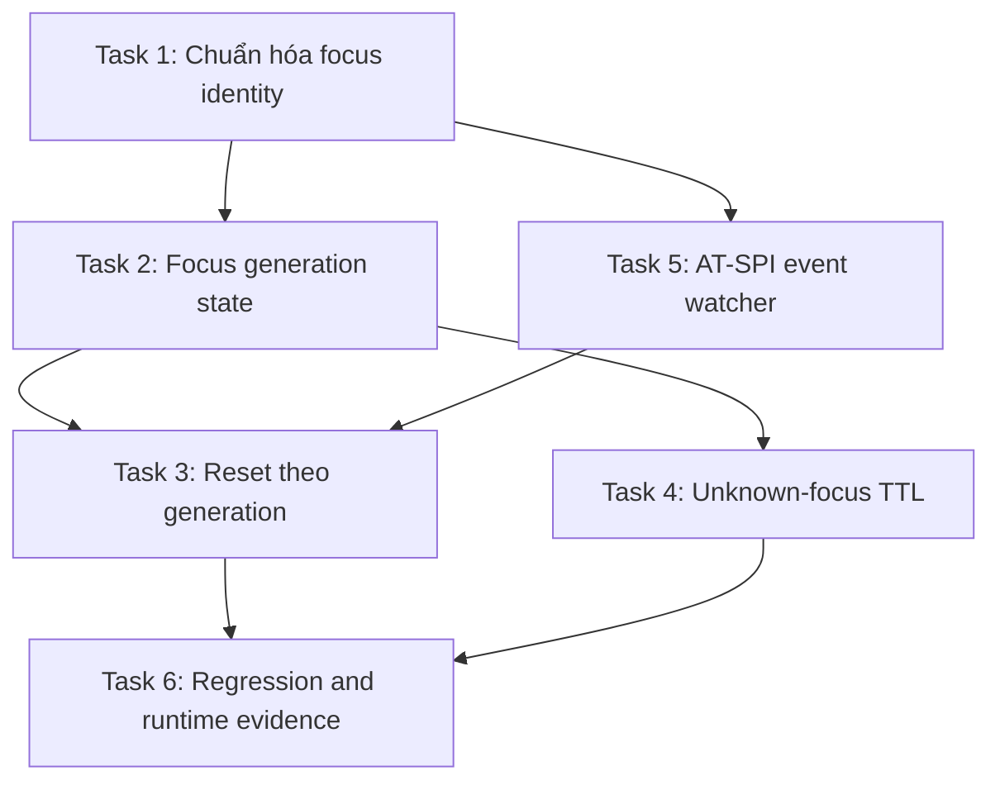

# Kế hoạch sửa lỗi stale Telex cache khi đổi ứng dụng trên COSMIC Wayland

## 1. Mục tiêu

Loại bỏ việc buffer Telex của cửa sổ cũ bị phát lại trong cửa sổ mới khi người dùng đổi focus mà chưa gõ ký tự flush như Space.

Tình huống tái hiện bắt buộc:

1. Trong ứng dụng A, gõ `con hổ` nhưng không nhấn Space.
2. Chuyển focus sang Telegram.
3. Gõ `xin chào`.
4. Kết quả phải là `xin chào`, không được thành `hoorxin chào`.

## 2. Root cause đã xác định

Trên COSMIC Wayland, các fallback X11 không cung cấp active window hợp lệ:

- `xprop -root _NET_ACTIVE_WINDOW` trả `0x0`.
- `get_active_window_id()` hiện coi `0x0` là một ID hợp lệ.
- Background tracker chỉ ghi nhận chuyển đổi ban đầu từ chuỗi rỗng sang `0x0`.
- Khi focus chuyển giữa các ứng dụng Wayland, giá trị vẫn là `0x0`.
- `evdev_loop` vì vậy không gọi `engine.reset()` và `replay_reset()`.
- Buffer chưa flush của ứng dụng A tiếp tục tồn tại và được engine áp dụng vào phím đầu tiên trong ứng dụng B.

Lỗi nằm ở contract nhận diện focus: code đang biến trạng thái “không xác định được cửa sổ” thành một định danh cửa sổ ổn định giả.

## 3. Đánh giá các phương án

### Phương án A: Sửa riêng `0x0`

Không cho `get_active_window_id()` và các X11 helper trả `0x0`.

Ưu điểm:

- Sửa đúng lỗi dữ liệu sai.
- Nhỏ, ít rủi ro.
- Ngăn log và state coi root/no-window là một cửa sổ thật.

Nhược điểm:

- Chỉ chuyển trạng thái từ “ID giả” sang “không có ID”.
- COSMIC vẫn không phát ra thay đổi focus đáng tin cậy.
- Một mình thay đổi này không thể reset cache khi đổi app.

Kết luận: bắt buộc thực hiện nhưng không đủ.

### Phương án B: Dùng foreign-toplevel Wayland protocol

Theo dõi toplevel và trạng thái activated bằng `wlr-foreign-toplevel-management` hoặc protocol tương đương.

Ưu điểm:

- Nếu compositor hỗ trợ, đây là nguồn focus gần compositor nhất.
- Có thể cung cấp app ID và lifecycle toplevel mà không cần X11.

Nhược điểm:

- Phiên COSMIC hiện tại không quảng bá foreign-toplevel global phù hợp qua kết quả kiểm kê.
- Protocol có thể bị compositor giới hạn theo policy.
- Không thể dùng làm bản sửa production bắt buộc cho máy hiện tại.

Kết luận: chỉ nên là capability tùy chọn trong tương lai, không phải fix chính.

### Phương án C: Dùng AT-SPI focus events

Đăng ký event focus/state-changed và tăng một focus generation khi focused accessible thay đổi.

Ưu điểm:

- Có thể hoạt động xuyên ứng dụng Wayland nếu ứng dụng export accessibility tree.
- Không phụ thuộc `_NET_ACTIVE_WINDOW`.
- Phù hợp để nhận biết chuyển focus giữa Edge/Telegram nếu cả hai expose accessibility.

Nhược điểm:

- Không phải mọi ứng dụng hoặc field đều expose AT-SPI đầy đủ.
- Accessibility có thể bị tắt hoặc event đến trễ.
- Không được đưa DFS hoặc truy vấn sâu Chromium DOM trở lại hot path vì investigation Edge đã loại bỏ cách đó.
- Cần event-driven watcher riêng, không poll toàn accessibility tree trên mỗi phím.

Kết luận: nguồn tín hiệu bổ sung tốt, nhưng phải có fallback correctness khi unavailable.

### Phương án D: Reset composition khi focus không quan sát được

Khi không có focus identity đáng tin cậy, không giữ composition vô hạn qua một khoảng idle đủ dài. Trước khi xử lý phím mới, nếu thời gian từ phím trước vượt ngưỡng bảo thủ thì invalidate/reset composition.

Ưu điểm:

- Không phụ thuộc compositor API.
- Chặn trực tiếp stale buffer tái xuất hiện sau thao tác chuyển app.
- Safe failure mode: mất khả năng tiếp tục một từ sau thời gian idle tốt hơn việc chèn text của app cũ vào app mới.

Nhược điểm:

- Không nhận biết được đổi app tức thời nếu người dùng Alt+Tab và gõ lại nhanh hơn ngưỡng.
- Ngưỡng quá thấp có thể reset giữa lúc người dùng đang suy nghĩ trong cùng một từ.
- Không nên dùng như một heuristic duy nhất.

Kết luận: fallback correctness bắt buộc khi focus provider báo unavailable.

## 4. Phương án được chọn

Dùng mô hình `FocusGeneration` với nhiều provider và fallback bảo thủ:

1. Không bao giờ coi `0x0`, `0`, chuỗi rỗng hoặc root window là focus identity hợp lệ.
2. Chuẩn hóa mọi nguồn focus thành một kiểu kết quả rõ ràng:
   - `Known(identity)`
   - `Changed(identity, generation)`
   - `Unavailable`
3. Provider hiện có cho Hyprland, Sway, GNOME và X11 tiếp tục được dùng khi trả identity hợp lệ.
4. Thêm AT-SPI watcher event-driven làm nguồn generation bổ sung trên COSMIC.
5. `evdev_loop` reset cả engine và replay state khi generation thay đổi, không phụ thuộc app-state feature có bật hay không.
6. Khi mọi provider đều unavailable, áp dụng composition expiry bảo thủ trước phím tiếp theo.
7. Không đoán focus từ dòng đầu tiên của `wmctrl` hoặc `wlrctl`; danh sách toplevel không chứng minh cửa sổ đang activated.

Kiến trúc này ưu tiên correctness: khi không chắc composition còn thuộc cùng field, VietC phải discard cache nội bộ, không được phát lại cache vào target mới.

## 5. Ngưỡng fallback

Bắt đầu với `FOCUS_UNKNOWN_COMPOSITION_TTL = 750 ms`.

Lý do:

- Poll focus hiện tại chạy mỗi 250 ms.
- 750 ms cho phép ba chu kỳ quan sát trước khi fallback.
- Alt+Tab giữa hai app thường tạo khoảng nghỉ đủ để cache hết hạn.
- Không reset một từ đang được gõ liên tục ở tốc độ bình thường.

Ngưỡng phải là named constant và được test bằng fake clock. Không thêm env var production trước khi có nhu cầu cấu hình thực tế.

## 6. Dependency graph



## 7. Kế hoạch triển khai

### Task 1: Chuẩn hóa và kiểm thử focus identity

**Mô tả:** Tách parser/validator cho active window ID. Tất cả fallback X11 phải từ chối `0x0`, `0`, chuỗi rỗng và root/no-window sentinel.

**Acceptance criteria:**

- `xprop` trả `0x0` dẫn đến `None`.
- Direct X11 query không trả ID 0.
- ID hợp lệ vẫn được canonicalize và giữ nguyên semantics.

**Verification:**

```bash
cargo test -p vietc-daemon app_state
cargo clippy -p vietc-daemon --all-targets --all-features -- -D warnings
```

**Files dự kiến:**

- `daemon/src/app_state.rs`
- Tests trong `daemon/src/app_state.rs`

**Scope:** Small

### Task 2: Tạo contract `FocusSnapshot` và generation

**Mô tả:** Thay hai chuỗi rời `active_window`/`window_class` bằng snapshot có identity, class, generation và reliability. Background watcher chỉ tăng generation khi có bằng chứng focus thay đổi.

**Acceptance criteria:**

- Unknown không bị chuyển thành một identity giả.
- Known identity thay đổi làm generation tăng đúng một lần.
- Class update của cùng identity không tạo focus transition giả.

**Verification:**

```bash
cargo test -p vietc-daemon focus
```

**Files dự kiến:**

- `daemon/src/app_state.rs`
- `daemon/src/main.rs`
- `daemon/src/evdev_loop.rs`

**Scope:** Medium

### Checkpoint 1

- Tất cả parser/focus unit tests pass.
- COSMIC log không còn `window ID '' -> '0x0'`.
- Không thay đổi behavior trên Hyprland, Sway, GNOME hoặc X11 khi identity hợp lệ.

### Task 3: Reset composition độc lập với app-state policy

**Mô tả:** Khi focus generation thay đổi, gọi một helper duy nhất để reset `engine`, `event_store`, `screen_output` và mọi replay state trước khi xử lý phím đầu tiên của target mới.

**Acceptance criteria:**

- Reset xảy ra dù `config.app_state.enabled` là true hay false.
- App policy evaluation vẫn chỉ chạy khi app-state feature bật.
- Không để `visible_revision` hoặc replacement acknowledgement của target cũ áp dụng vào target mới.

**Verification:**

```bash
cargo test -p vietc-daemon focus_change
cargo test -p vietc-daemon inject::tests
```

**Files dự kiến:**

- `daemon/src/daemon.rs`
- `daemon/src/evdev_loop.rs`
- Tests của daemon

**Scope:** Medium

### Task 4: Thêm TTL khi focus provider unavailable

**Mô tả:** Nếu focus identity không đáng tin cậy, hết hạn composition chưa flush sau 750 ms idle trước khi xử lý phím tiếp theo.

**Acceptance criteria:**

- Buffer `hoor` bị discard sau TTL khi focus unknown.
- Gõ liên tục trong cùng từ dưới TTL không bị reset.
- Flush char và explicit reset vẫn hoạt động như hiện tại.
- Test dùng fake clock hoặc helper thuần, không sleep thật.

**Verification:**

```bash
cargo test -p vietc-daemon unknown_focus
cargo test -p vietc-engine
```

**Files dự kiến:**

- `daemon/src/evdev_loop.rs`
- Có thể thêm helper nhỏ trong `daemon/src/daemon.rs`
- Tests của daemon

**Scope:** Medium

### Task 5: Thêm AT-SPI focus watcher event-driven cho COSMIC

**Mô tả:** Đăng ký focus/state-changed event ở thread nền và chỉ xuất generation/app identity tối thiểu. Không duyệt Chromium accessibility tree và không gọi AT-SPI trong hot path từng phím.

**Acceptance criteria:**

- Edge sang Telegram tạo generation mới khi AT-SPI khả dụng.
- Watcher unavailable hoặc restart không làm daemon crash.
- Nội dung text field và user input không được ghi log.
- Event storm được deduplicate theo accessible/application identity.

**Verification:**

```bash
cargo test -p vietc-daemon atspi_focus
```

Manual runtime:

- Mở Edge, gõ từ chưa flush.
- Chuyển Telegram và gõ ngay trong dưới 750 ms.
- Xác nhận cache cũ không xuất hiện.
- Tắt accessibility service và lặp lại sau hơn 750 ms để xác nhận fallback.

**Files dự kiến:**

- `daemon/src/password_detector.rs` hoặc module mới `daemon/src/focus_tracker.rs`
- `daemon/src/main.rs`
- `daemon/src/evdev_loop.rs`
- Tests của daemon

**Scope:** Medium

### Checkpoint 2

- Fast switch được bảo vệ bởi AT-SPI generation khi signal tồn tại.
- Slow switch được bảo vệ bởi unknown-focus TTL.
- Không poll accessibility tree trên mỗi keystroke.
- Không tái phát Edge SIGILL.

### Task 6: Regression harness và runtime matrix

**Mô tả:** Thêm fixture mô hình hóa hai target khác nhau và runtime scenario đúng theo bug report.

**Acceptance criteria:**

- Automated test chứng minh composition của target A không xuất hiện trong target B.
- Runtime artifact ghi focus provider, generation transition, expected/observed text và process health.
- Edge không crash và core delta bằng 0.
- Clipboard vẫn được preserve.
- Chromium, Chrome, GTK, Qt và terminal không regression.

**Verification:**

```bash
cargo fmt --all -- --check
cargo test --workspace --all-targets
cargo clippy --workspace --all-targets --all-features -- -D warnings
VIETC_RUNTIME_TESTS=1 VIETC_CONTROLLED_DISPLAY=1 \
VIETC_RUNTIME_TARGETS=chromium,google-chrome,zenity,python3,xterm \
cargo test -p vietc-daemon --test runtime \
privileged_runtime_targets_execute_controlled_scenarios \
-- --ignored --nocapture --test-threads=1
```

Manual acceptance scenario:

1. Trong Edge gõ `con hổ`, không bấm Space.
2. Chuyển ngay sang Telegram.
3. Gõ `xin chào`.
4. Telegram chỉ hiển thị `xin chào`.
5. Lặp lại tối thiểu 20 lần với switch nhanh và switch sau 1 giây.
6. Xác nhận không core dump Edge mới.

**Files dự kiến:**

- `daemon/tests/runtime.rs`
- `daemon/tests/daemon_suite.rs`
- `docs/testing-dictionary.md`
- `tasks/edge-sigill-vietc-technical-investigation.md`

**Scope:** Medium

## 8. Rủi ro và giảm thiểu

| Rủi ro | Mức độ | Giảm thiểu |
|---|---|---|
| AT-SPI không phát event cho một số ứng dụng | Cao | Bắt buộc giữ unknown-focus TTL |
| TTL reset giữa lúc người dùng dừng trong cùng một từ | Trung bình | Bắt đầu 750 ms, đo runtime, chỉ áp dụng khi focus unavailable |
| Focus event đến sau phím đầu tiên | Cao | Generation được đọc ngay trước xử lý key; TTL là lớp dự phòng |
| Reset thiếu một state phụ | Cao | Dùng một helper reset composition duy nhất |
| Foreign-toplevel chưa có trên COSMIC hiện tại | Thấp | Không lấy protocol này làm dependency bắt buộc |
| Tái kích hoạt đường accessibility gây Edge instability | Cao | Event subscription tối thiểu, không DFS Chromium tree |
| Regression trên compositor khác | Trung bình | Provider-specific tests và runtime matrix |

## 9. Definition of done

- `0x0` không bao giờ được coi là cửa sổ hợp lệ.
- Focus generation thay đổi reset toàn bộ composition state.
- Khi focus unknown, stale composition hết hạn sau 750 ms.
- Reproduction Edge → Telegram không còn `hoorxin chào`.
- Switch nhanh và switch chậm đều có coverage.
- Edge core delta bằng 0.
- Clipboard preservation vẫn pass.
- Workspace tests, format và strict Clippy pass.
- Runtime Chromium, Chrome, GTK, Qt và terminal pass.