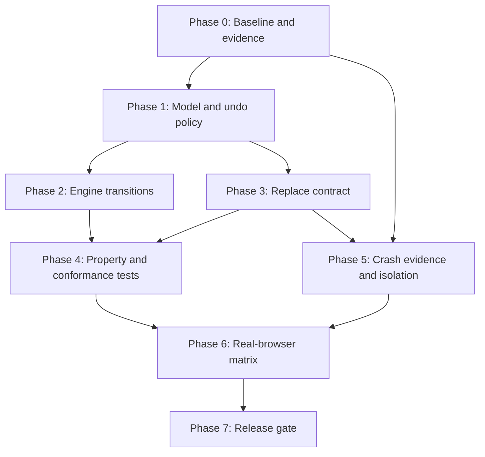

# Ke hoach toan cuc: Telex state machine va dieu tra Chromium crash

## 1. Muc tieu

Thay cac nhanh xu ly Telex cuc bo bang mot mo hinh duy nhat, co the kiem chung, dua tren ba thanh phan:

- `raw physical input`: chuoi phim vat ly ma nguoi dung da nhap.
- `visible composition`: chuoi ma frontend du kien dang hien thi.
- `active transform identity`: phep bien doi dang hoat dong, gom loai transform, vi tri nguon, trigger, ket qua va undo policy.

Dong thoi, xay dung quy trinh thu thap bang chung cho loi Chromium, Chrome hoac Electron bi thoat khi go tieng Viet. Khong gan root cause cho engine, injector, clipboard hay browser neu chua co crash artifact va minimized reproduction.

Khong nam trong scope cua ke hoach nay:

- Sua source code ngay trong task lap ke hoach.
- Commit thay doi.
- Viet workaround rieng cho tung tu hoac tung chuoi mau.
- Dung deterministic fake test de thay the runtime proof tren browser that.

## 2. Nguyen tac va invariant

1. Moi physical key press duoc xu ly dung mot lan va co identity on dinh trong transition log.
2. `raw input` khong bi suy ra nguoc tu Unicode output.
3. `visible composition` chi thay doi qua transition cua engine hoac qua event dong bo frontend co contract ro rang.
4. Tai moi thoi diem chi co mot `active transform identity` cho phep undo; transform moi phai thay the, ke thua hoac dong transform cu theo bang transition.
5. Undo cung state va cung input phai cho cung ket qua tren moi frontend.
6. Frontend khong tu cong them backspace cho trigger, khong tu doan trigger da den ung dung, va khong tu tai tao `Replace`.
7. `EngineEvent::Replace` la transaction logic duy nhat: xoa mot so Unicode scalar dang hien thi va chen chuoi thay the, hoac bao failure. Khong bao success neu chi xoa thanh cong.
8. Word boundary, cursor move, delete, paste, focus change va backend failure phai dong composition bang transition duoc dinh nghia.
9. Khong duplicate/drop ky tu, khong de stuck modifier, khong mat clipboard, khong silent data loss.
10. Crash investigation phai phan loai process bi loi truoc khi sua code.

## 3. Mo hinh state machine de xuat

### 3.1 State toi thieu

- `raw_keys`: danh sach physical input ke tu word boundary gan nhat.
- `visible`: Unicode composition hien tai.
- `cursor`: vi tri logic trong composition; phase dau chi chap nhan end-of-buffer, vi tri khac buoc flush.
- `active_transform`: `None` hoac identity gom:
  - `kind`: tone, mark, stroke.
  - `source_span`: mien raw va visible da bien doi.
  - `trigger`: physical trigger goc.
  - `result`: visible result.
  - `undo_policy`: AppendTrigger hoac ConsumeTrigger.
  - `generation`: tang khi transform bi thay the.
- `case_shape`: lower, upper hoac mixed case tai source span.
- `validity`: unknown, valid Vietnamese, invalid Vietnamese.
- `boundary_state`: composing, committed hoac invalidated.

### 3.2 Input alphabet

- Printable physical key.
- Tone trigger `f`, `s`, `r`, `x`, `j`.
- Mark trigger `w`, repeated vowel pairs `aa`, `ee`, `oo`.
- Stroke trigger `dd`.
- Backspace, Delete, cursor/navigation key.
- Word boundary, focus change, paste va reset.
- Frontend acknowledgement hoac injection failure.

### 3.3 Transform identity

Identity khong chi la ky tu ket qua. No phai ghi phep bien doi cu the, vi du tone-s tren nucleus span, mark-aw tai vowel index, hoac stroke-dd tai source pair. Khi tone/mark moi di chuyen vi tri dau, thay ket qua, hoac spelling validation loai bo transform, generation cu bi dong. Trigger lap lai chi undo neu khop active identity hien tai.

### 3.4 Transition classes

- `Start`: append raw key va tao visible composition.
- `Apply`: tao transform moi tu raw sequence.
- `ReplaceActive`: transform moi thay transform cu, bao toan raw history.
- `UndoActive`: ap dung policy cua active identity.
- `Edit`: Backspace cap nhat raw, visible va active identity theo cung mot transition.
- `Invalidate`: Delete, cursor move, selection, paste hoac external edit dong composition.
- `Commit`: word boundary chot output va chay auto-restore.
- `Recover`: frontend failure giu state co the replay hoac reset an toan, khong gia vo visible da thay doi.

## 4. Bang undo policy bat buoc

Bang nay la baseline can duoc khoa bang model tests; thay doi sau nay phai la quyet dinh contract, khong phai nhanh frontend.

- Tone `f/s/r/x/j`: `AppendTrigger`. Trigger lap lai tren dung active tone identity bo tone va giu trigger thu hai nhu literal input. Neu active transform da bi mark/tone khac thay the, trigger duoc xu ly nhu transition moi, khong undo identity cu.
- Mark `aw`, `aa`, `ee`, `oo`, `ow`, `uw`: `AppendTrigger`. Trigger lap lai tren dung active mark identity tra ve base spelling va append trigger literal.
- Smart `uo + w` va `ua + w`: cung identity mark-`w`, cung policy `AppendTrigger`; khong co policy rieng theo tu.
- Stroke `dd`: `ConsumeTrigger`. `dd` tao `d`; physical `d` tiep theo tren dung active identity huy stroke, tao visible `dd`, va trigger undo da duoc tieu thu trong raw pair. Khong append them `d` thu ba.
- Output chuan cho stroke undo la `ddd -> dd`, `DDd -> DD` va `dDd -> dD`; case shape duoc bao toan tu raw physical pair.
- VNI transforms: khong nam trong undo Telex policy, nhung phai chay cung state model va edit/boundary contract.

Quyet dinh Phase 1: `dd` dung `ConsumeTrigger`. Bat ky thay doi sang `AppendTrigger` sau nay phai co ADR, migration behavior va regression update rieng.

## 5. Contract duy nhat cho `EngineEvent::Replace`

Contract de xuat:

```text
Replace {
  expected_visible_revision,
  delete_before_cursor,
  insert,
  resulting_visible,
  reason,
  transform_generation
}
```

Semantics:

- Don vi xoa la Unicode scalar count cho engine contract; frontend adapter chiu trach nhiem map sang protocol unit neu protocol dung byte hay UTF-16.
- `delete_before_cursor` chi tinh phan visible composition do engine so huu, khong gom physical trigger frontend tu suy luan.
- Event mang revision/generation de reject stale replacement va ngan feedback.
- Backend phai thi hanh delete va insert nhu mot transaction quan sat duoc, hoac tra failure.
- Grabbed evdev, non-grabbed evdev, Wayland IM, IBus, X11 va clipboard fallback cung consume mot semantic event.
- Khac biet backend chi nam trong adapter: consume physical key, preedit/commit, direct injection hay clipboard.
- Non-grabbed evdev khong tu `+1 backspace`; engine/front-controller phai biet physical key da visible hay chua qua delivery acknowledgement.
- Wayland IM va IBus khong suy ra replacement tu preedit string diff neu engine da phat event.
- X11 va clipboard fallback khong duoc bao thanh cong neu delete da xay ra nhung insert that bai.

Truoc implementation can quyet dinh co mo rong enum hien tai hay them envelope versioned de tranh pha API noi bo.

## 6. Chien luoc test toan cuc

### 6.1 Model-based oracle

Viet reference model thuan, khong I/O, nhan physical events va tra state/replace transaction. Production engine va model chay cung generated trace; so sanh:

- raw history.
- visible composition.
- active identity va generation.
- frontend-neutral event stream.
- final committed text.

### 6.2 Property-based coverage

Generator phai phu:

- Tone triggers `f/s/r/x/j`.
- Mark triggers `w/aa/ee/oo`, smart `uo/ua + w`, va `dd`.
- Lower, upper va mixed case.
- Mot hoac nhieu nguyen am; onset `qu/gi`; tone placement.
- Consonant chen giua vowel va trigger.
- Trigger lap, trigger khong sat transform, transform bi transform khac thay the.
- Valid va invalid Vietnamese spelling.
- Auto-restore bat/tat.
- Backspace, Delete, cursor move, word boundary, paste va focus reset.
- Frontend delivery modes: consumed-before-visible, visible-before-replace va preedit-owned.
- Replacement failure tai delete, insert va acknowledgement.

Properties bat buoc:

- Determinism: cung initial state va trace cho cung state/event stream.
- Replay equivalence: replay raw history cho cung visible output.
- Undo involution theo policy: apply roi undo cho ket qua duoc policy dinh nghia.
- Frontend conformance: moi adapter cho cung final text tren cung delivery model.
- No stale undo: trigger khong undo transform identity da bi thay the.
- Editing safety: edit invalidating event khong de active identity mo coi.
- Transaction safety: failure khong duoc danh dau visible revision moi.
- Case preservation: transform va undo bao toan case shape.

Regression examples ton tai ben can properties, gom `ATXX -> ATX`, tat ca tone double-trigger, `ddd`, mixed-case `DdD`, multi-vowel, non-adjacent trigger va auto-restore boundary.

## 7. Workflow dieu tra Chromium, Chrome va Electron crash

### 7.1 Khong ket luan khi chua co bang chung

Moi reproduction phai phan vao mot trong bon lop:

- Daemon crash: `vietc` process thoat, panic, abort hoac bi signal.
- Renderer crash: tab/web contents/render process thoat nhung browser process con song.
- Browser process crash: process chinh Chromium/Chrome/Electron thoat.
- Protocol-triggered app exit: app tu dong dong do compositor/Wayland/X11/clipboard/protocol disconnect hoac fatal validation.

Neu chi thay cua so bien mat, trang reload hay daemon restart thi chua du de gan nhan.

### 7.2 Evidence bundle bat buoc

- UTC timestamp va reproduction ID.
- Lenh khoi dong, stderr/stdout day du cua daemon va app.
- `journalctl` theo user/system unit trong cua so thoi gian loi.
- `coredumpctl list/info/debug` cho moi PID lien quan.
- Browser/app name, exact version, command line va enabled flags.
- Distro, kernel, session type, compositor va version.
- Backend dang dung: grabbed/non-grabbed evdev, Wayland IM, IBus, X11, uinput, wtype hay clipboard.
- Input method/config, auto-restore va dedup settings.
- Reproduction steps, physical sequence va minimized sequence.
- Process tree/PID map de xac dinh process nao chet.
- Browser crash ID/log neu available.
- Clipboard state va modifier state truoc/sau reproduction.

Du lieu nhay cam phai duoc redact; khong log toan bo input nguoi dung ngoai controlled test fixture.

### 7.3 Nghi pham va phep phan biet

- `wtype` Shift-prefix: trace press/release, thu khong prefix, thu khi physical Shift dang giu.
- Forced modifier release: chup XKB/evdev state truoc/sau, kiem tra injector chi release modifier no da press.
- Ctrl+V fallback: tat rieng fallback, so sanh direct Wayland/X11 insertion.
- Malformed/too-fast sequence: replay cung event voi timestamp co dinh va tang delay co kiem soat.
- Clipboard ownership: trace owner, TARGETS/UTF8_STRING/STRING request va restore revision.
- X11 SelectionRequest: ghi supported/unsupported target, property, timeout va owner lifetime.
- Injection feedback: gan transaction ID va dem event bi recapture.
- Concurrent writes: serialize transaction va trace writer/thread identity.
- Process lifecycle: kiem tra child exit, zombie, restorer shutdown va descriptor lifetime.
- Protocol misuse: bat Wayland/X11 debug/validation log va doi chieu fatal error voi PID.

Moi nghi pham can mot hypothesis co the bac bo va mot experiment chi thay doi mot bien.

## 8. CI va runtime harness

### 8.1 Deterministic CI

- Model-based/property tests chay khong display server.
- Fake frontend adapters tuan cung Replace conformance suite.
- Fake clock va bounded timeout cho clipboard, selection va lifecycle.
- Seed loi duoc in va luu thanh regression corpus.
- Failure injection tai moi buoc delete, insert, flush, acknowledgement va restore.
- State-machine traces duoc shrink thanh minimized sequence.

### 8.2 Runtime harness rieng

- Khoi dong Chromium, Chrome va Electron that voi profile tam moi cho moi test.
- Gan PID/process type, thu stderr, journal va core metadata.
- Su dung text field fixture co observable value va crash detector.
- Moi scenario co hard timeout, teardown va kill/reap.
- Khong danh dau PASS neu chi process khoi dong; phai xac minh text, process health, modifier va clipboard.
- Artifact ghi engine build, app version, compositor, backend, sequence, timing va logs.
- Privileged uinput tests chay job rieng; khong gia vo la unit test.

Runtime matrix:

- COSMIC Wayland.
- GNOME Wayland.
- KDE Wayland.
- X11.
- Chromium.
- Google Chrome.
- Electron.
- GTK.
- Qt.
- Terminal.

## 9. Phases va tasks

### Phase 0: Baseline va evidence contract

#### Task 0.1: Dong bang behavior va telemetry toi thieu

**Hypothesis:** Hien tai khong the phan biet engine defect, adapter divergence va app crash vi thieu trace identity va process evidence.

**RED:** Cung sequence khong the noi ket qua den tu frontend nao, transaction nao hoac process nao thoat.

**GREEN:** Co schema trace/evidence versioned, redact input va co fixture tao bundle day du.

**Acceptance criteria:**

- Dinh nghia reproduction ID, transaction ID, visible revision va process classification.
- Tool thu thap khong ket luan root cause.
- Baseline luu output cho cac regression hien co va `ATXX -> ATX`.

**Files du kien:**

- `docs/testing-dictionary.md`
- `daemon/tests/runtime.rs`
- `daemon/tests/common/`
- `scripts/setup-test-vm.sh`

**Verification:**

```bash
cargo test -p vietc-daemon --test runtime
cargo test -p vietc-engine
```

**Risk:** Telemetry vo tinh log input that.

**Rollback:** Tat trace payload, giu ID va metadata khong chua noi dung.

### Phase 1: Reference model va undo policy

#### Task 1.1: Dinh nghia state, transition va active transform identity

**Hypothesis:** Loi undo phat sinh vi composition va transform identity dang bi suy ra tu output thay vi duoc luu nhu state.

**RED:** Generated traces tim thay hai history khac nhau bi xem nhu cung active transform hoac stale transform bi undo.

**GREEN:** Reference model phan biet history, generation va validity; moi transition co oracle.

**Acceptance criteria:**

- State bao gom raw, visible, transform identity, case, validity va boundary.
- Transition day du cho printable, edit, paste, cursor va boundary.
- Khong co word-specific condition.

**Files du kien:**

- `engine/src/bamboo.rs`
- `engine/src/input_method.rs`
- `engine/tests/state_machine_model.rs`

**Verification:**

```bash
cargo test -p vietc-engine state_machine_model -- --nocapture
```

**Risk:** Model vo tinh copy bug cua implementation.

**Rollback:** Giu model toi gian, dua oracle vao spec table va independent transition reducer.

#### Task 1.2: Khoa bang policy cho tone, mark va dd

**Hypothesis:** Policy khong day du lam cac trigger lap lai va mixed-case phu thuoc nhanh xu ly.

**RED:** Bang generated cases cho output khac nhau theo vi tri trigger, case hoac frontend.

**GREEN:** Moi transform co policy chinh xac va tests phu toan bo trigger family.

**Acceptance criteria:**

- Tone `f/s/r/x/j` va mark `w/aa/ee/oo` co policy.
- `dd` duoc khoa la ConsumeTrigger hoac thay doi bang ADR truoc code.
- Smart transform va transform replacement tuan identity/generation.

**Files du kien:**

- `engine/src/input_method.rs`
- `engine/src/bamboo.rs`
- `engine/tests/state_machine_model.rs`
- `docs/` hoac artifact quyet dinh phu hop

**Verification:**

```bash
cargo test -p vietc-engine undo_policy -- --nocapture
```

**Risk:** Thay doi muscle memory cua nguoi dung.

**Rollback:** Feature flag policy version trong mot release chuyen tiep, khong fork frontend.

### Phase 2: Engine transition va edit semantics

#### Task 2.1: Dua engine ve reducer tren physical events

**Hypothesis:** Tach `raw_buffer`, Bamboo composition va frontend workarounds tao state khong dong bo.

**RED:** Property tests tim duoc replay mismatch hoac active identity mo coi.

**GREEN:** Production reducer khop reference model tren generated corpus.

**Acceptance criteria:**

- Tat ca Telex transform di qua mot transition path.
- Bao toan case va multi-vowel placement.
- Invalid spelling va auto-restore la transition commit, khong sua raw history.

**Files du kien:**

- `engine/src/bamboo.rs`
- `engine/src/engine.rs`
- `engine/src/input_method.rs`
- `engine/tests/state_machine_model.rs`
- `engine/tests/auto_restore.rs`
- `engine/tests/tone_placement.rs`

**Verification:**

```bash
cargo test -p vietc-engine
```

**Risk:** Blast radius rong cho Telex/VNI.

**Rollback:** Giu reducer cu sau config compatibility trong thoi gian rollout; corpus chay ca hai.

#### Task 2.2: Chot Backspace, Delete, cursor va boundary

**Hypothesis:** Edit ngoai append-only lam raw/visible/transform lech nhau.

**RED:** Generated edit traces de stale undo hoac replay khac visible.

**GREEN:** Backspace co inverse transition; Delete/cursor/external edit flush hoac invalidate deterministic.

**Acceptance criteria:**

- Hanh vi cho end-of-buffer Backspace duoc model hoa.
- Delete, navigation, selection, paste va focus change co transition.
- Word boundary va auto-restore khong race voi ky tu boundary.

**Files du kien:**

- `engine/src/engine.rs`
- `engine/src/event.rs`
- `daemon/src/wayland_im.rs`
- `daemon/src/ibus_engine.rs`
- Tests engine va daemon lien quan

**Verification:**

```bash
cargo test -p vietc-engine
cargo test -p vietc-daemon
```

**Risk:** Protocol khong cung cap surrounding-text/cursor day du.

**Rollback:** Flush composition truoc unsupported edit thay vi co gang tiep tuc.

### Phase 3: Replace contract va frontend conformance

#### Task 3.1: Version hoa `EngineEvent::Replace`

**Hypothesis:** `backspaces + insert` khong mang delivery/revision semantics nen frontend phai tu suy luan.

**RED:** Conformance test cho thay grabbed va non-grabbed can sua count khac nhau.

**GREEN:** Mot event contract chay qua delivery acknowledgement va cho cung final text.

**Acceptance criteria:**

- Contract dinh nghia unit, ownership, revision, reason va failure.
- Khong adapter nao `+1`, `saturating_sub` hoac diff lai semantics.
- Stale event bi reject deterministic.

**Files du kien:**

- `engine/src/engine.rs`
- `daemon/src/commands.rs`
- `daemon/src/controller.rs`
- `daemon/src/inject.rs`
- Shared conformance tests

**Verification:**

```bash
cargo test -p vietc-engine
cargo test -p vietc-daemon inject
```

**Risk:** API churn noi bo.

**Rollback:** Adapter tam tu event version moi sang backend cu, khong cho frontend tu tinh lai.

#### Task 3.2: Dong nhat grabbed va non-grabbed evdev

**Hypothesis:** Non-grabbed `+1 backspace` va fallback tu buffer diff gay duplicate/drop.

**RED:** Cung physical trace cho command stream khac semantics.

**GREEN:** Hai mode consume cung Replace event voi delivery state explicit.

**Acceptance criteria:**

- Bo frontend inference cho control key da visible.
- Modifier va dedup khong pha transaction identity.
- Failure khong cap nhat visible revision.

**Files du kien:**

- `daemon/src/evdev_loop.rs`
- `daemon/src/inject.rs`
- `daemon/tests/runtime.rs`

**Verification:**

```bash
cargo test -p vietc-daemon evdev
cargo test -p vietc-daemon --test runtime
```

**Risk:** Ung dung co event delivery timing khac nhau.

**Rollback:** Chon delivery mode bang capability/backend, khong dua vao word case.

#### Task 3.3: Dong nhat Wayland IM va IBus

**Hypothesis:** Preedit/commit va surrounding-text dang tao semantics rieng.

**RED:** Conformance suite cho final text hoac boundary khac evdev.

**GREEN:** Wayland IM va IBus map event contract sang protocol operation ma khong tai suy luan.

**Acceptance criteria:**

- Preedit revision dong bo voi engine revision.
- Commit/boundary khong double-forward.
- Backspace/cursor unsupported buoc flush an toan.

**Files du kien:**

- `daemon/src/wayland_im.rs`
- `daemon/src/ibus_engine.rs`
- Tests adapter lien quan

**Verification:**

```bash
cargo test -p vietc-daemon wayland_im
cargo test -p vietc-daemon ibus
```

**Risk:** Khac biet lifecycle giua protocol.

**Rollback:** Commit preedit va reset tai boundary khong du capability.

#### Task 3.4: Dong nhat uinput, X11 va clipboard fallback

**Hypothesis:** Delete va insert tach kenh hoac ownership timeout tao partial success va feedback.

**RED:** Failure injection tim thay xoa thanh cong, chen fail hoac success khong co observable insert.

**GREEN:** Adapter tra transaction outcome that, co feedback guard va clipboard revision.

**Acceptance criteria:**

- `protocol/src/uinput_monitor.rs` va `protocol/src/x11_inject.rs` dung cung outcome contract.
- Forced modifier release chi ap dung modifier do injector press.
- Clipboard/X11 selection failure khong bao success.

**Files du kien:**

- `protocol/src/inject.rs`
- `protocol/src/uinput_monitor.rs`
- `protocol/src/x11_inject.rs`
- `daemon/src/inject.rs`
- Protocol va runtime tests

**Verification:**

```bash
cargo test -p vietc-protocol
cargo test -p vietc-daemon inject
```

**Risk:** Khong the atomic thuc su qua clipboard.

**Rollback:** Bao NotSupported/Failed va giu composition recoverable, khong silent fallback.

### Phase 4: Property/model test gate

#### Task 4.1: Sinh trace toan bo Telex va shrink failure

**Hypothesis:** Regression examples khong phu duoc interaction giua trigger, case, transform replacement va edit.

**RED:** Seed corpus tim invariant violation tren implementation hien tai.

**GREEN:** Generated traces khop model, failure luu seed va minimized sequence.

**Acceptance criteria:**

- Phu tat ca trigger va dimensions tai muc 6.
- Co regression `ATXX -> ATX`.
- Khong dung random test khong reproducible.

**Files du kien:**

- `engine/Cargo.toml`
- `engine/tests/state_machine_properties.rs`
- `engine/tests/testdata/`

**Verification:**

```bash
cargo test -p vietc-engine --test state_machine_properties -- --nocapture
```

**Risk:** Test space lon va CI cham.

**Rollback:** Tach smoke seed set va nightly exhaustive budget, cung dung mot model.

#### Task 4.2: Frontend contract conformance suite

**Hypothesis:** Engine dung nhung adapter co the diverge.

**RED:** Adapter cho command/outcome khac nhau tren cung abstract delivery trace.

**GREEN:** Moi frontend pass cung fixtures va failure matrix.

**Acceptance criteria:**

- Grabbed, non-grabbed, Wayland IM, IBus, X11 va clipboard duoc bao phu.
- Test duplicate/drop, modifier, stale revision va partial failure.
- Them frontend moi phai pass suite nay.

**Files du kien:**

- `daemon/tests/runtime.rs`
- `daemon/tests/common/`
- `protocol` tests

**Verification:**

```bash
cargo test -p vietc-daemon --test runtime
cargo test -p vietc-protocol
```

**Risk:** Fake adapter qua don gian.

**Rollback:** Bat adapter ghi observable trace va replay cung trace trong runtime harness.

### Phase 5: Chromium crash evidence va isolation

#### Task 5.1: Tao crash evidence collector

**Hypothesis:** Bao cao hien tai gom nhieu loai process exit thanh mot loi Chromium crash.

**RED:** Reproduction khong chi ra PID/process type va khong co journal/core/stderr bundle.

**GREEN:** Moi run tao manifest va phan loai duoc daemon, renderer, browser hay protocol exit.

**Acceptance criteria:**

- Thu journal, stderr, coredump metadata, versions, session/compositor va backend.
- Luu exact/minimized sequence va timestamps.
- Khong luu input ngoai fixture.

**Files du kien:**

- `daemon/tests/common/`
- `scripts/`
- `docs/testing-dictionary.md`

**Verification:**

```bash
cargo test -p vietc-daemon --test runtime evidence
```

**Risk:** `coredumpctl` hoac browser crash reporter khong co tren moi distro.

**Rollback:** Mark capability missing trong manifest; khong suy dien absence of crash.

#### Task 5.2: Chay hypothesis matrix mot bien moi lan

**Hypothesis:** Mot trong cac kenh modifier, clipboard, selection, feedback, concurrency, lifecycle hoac protocol misuse gay exit.

**RED:** Baseline reproduction co evidence nhung chua isolate duoc bien.

**GREEN:** Moi nghi pham co experiment bat/tat, outcome va evidence; root cause chi duoc gan khi co correlation va reproduction.

**Acceptance criteria:**

- Kiem tra du cac nghi pham tai muc 7.3.
- Moi experiment co control run.
- Sequence duoc minimize bang delta debugging/model shrink.

**Files du kien:**

- `daemon/tests/runtime.rs`
- `daemon/tests/common/`
- `protocol` runtime fixtures
- `docs/testing-dictionary.md`

**Verification:**

```bash
VIETC_RUNTIME_TESTS=1 cargo test -p vietc-daemon --test runtime -- --test-threads=1 --nocapture
```

**Risk:** Flaky reproduction hoac environment-dependent crash.

**Rollback:** Tang so lan lap co gioi han, luu timing distribution, khong sua code theo anecdote.

### Phase 6: Real-browser runtime harness

#### Task 6.1: Chromium, Chrome va Electron lifecycle harness

**Hypothesis:** Deterministic fake tests khong phat hien protocol/process failure trong browser that.

**RED:** Harness chi biet app khoi dong, khong phat hien renderer/browser exit hay text sai.

**GREEN:** Harness kiem tra process health, observable text, clipboard va modifier sau moi sequence.

**Acceptance criteria:**

- Profile tam, PID map, stderr va timeout.
- Phan biet tab/renderer/browser/daemon exit.
- Teardown kill/reap tat ca child.

**Files du kien:**

- `daemon/tests/runtime.rs`
- `daemon/tests/common/`
- `scripts/setup-test-vm.sh`

**Verification:**

```bash
VIETC_RUNTIME_TESTS=1 cargo test -p vietc-daemon --test runtime browser -- --test-threads=1 --nocapture
```

**Risk:** Browser sandbox va automation khac distro.

**Rollback:** Container/VM image rieng theo matrix, khong ha security flag trong default user environment.

#### Task 6.2: Chay desktop/runtime matrix

**Hypothesis:** Backend/compositor/app toolkit interaction co the chi xuat hien trong mot o matrix.

**RED:** O matrix chi ghi READY/SKIPPED ma khong chay observable scenario.

**GREEN:** Moi o co PASS/FAIL/SKIP voi reason, versions, logs va timeout.

**Acceptance criteria:**

- Bao phu COSMIC, GNOME, KDE Wayland va X11.
- Bao phu Chromium, Chrome, Electron, GTK, Qt va terminal.
- Failure artifact gan dung environment va minimized sequence.

**Files du kien:**

- `daemon/tests/runtime.rs`
- `daemon/tests/common/`
- `.github/workflows/` hoac runtime CI config
- `scripts/setup-test-vm.sh`

**Verification:**

```bash
VIETC_RUNTIME_TESTS=1 cargo test -p vietc-daemon --test runtime matrix -- --test-threads=1 --nocapture
```

**Risk:** Khong co san tat ca desktop session trong mot runner.

**Rollback:** Matrix job tach theo image/VM; missing environment la SKIP co owner, khong PASS.

### Phase 7: Release gate

#### Task 7.1: Full workspace va runtime sign-off

**Hypothesis:** Unit pass khong du de chung minh khong regression tren input path that.

**RED:** Bat ky invariant, conformance test hoac runtime cell bat buoc fail/missing.

**GREEN:** Tat ca automated gate va runtime evidence bat buoc pass.

**Acceptance criteria:**

- Khong duplicate/drop ky tu.
- Khong stuck modifier.
- Undo deterministic cho moi policy.
- Khong mat input hoac clipboard.
- Khong daemon, renderer, browser hay app crash do input path.
- Khong HIGH/CRITICAL mo; missing evidence la FAIL.

**Files du kien:**

- Tests va CI config lien quan
- Release evidence artifact

**Verification:**

```bash
cargo fmt --all -- --check
cargo test --workspace --all-targets
cargo clippy --workspace --all-targets --all-features -- -D warnings
VIETC_RUNTIME_TESTS=1 cargo test -p vietc-daemon --test runtime -- --test-threads=1 --nocapture
```

**Risk:** Runtime matrix ton nhieu tai nguyen.

**Rollback:** Khong release; khong ha gate hay doi missing evidence thanh PASS.

## 10. Dependency graph



## 11. Quy trinh commit khi implementation

Ke hoach nay khong tao commit. Khi implementation bat dau, moi task nen la thay doi nho co RED test truoc, GREEN implementation sau va verification rieng. Khong tron engine behavior, frontend migration, crash instrumentation va mechanical cleanup trong cung commit.

## 12. Diem can quyet dinh truoc implementation

1. Xac nhan `dd` dung `ConsumeTrigger` va output chuan cho `ddd`, `DDd`, `dDd`.
2. Chon cach version hoa `EngineEvent::Replace`: mo rong variant hay them envelope moi.
3. Chot don vi `delete_before_cursor` va cach adapter map sang UTF-8/UTF-16/protocol units.
4. Chot delivery acknowledgement cho non-grabbed evdev de bo hoan toan `+1 backspace`.
5. Chot unsupported cursor/Delete policy la flush hay surrounding-text synchronization.
6. Chot CI property-test budget va nightly exhaustive budget.
7. Chot runner/VM owner cho COSMIC, GNOME, KDE, X11 va cac browser/toolkit.
8. Chot redaction/retention policy cho crash evidence va input traces.

## 13. Release gate bat buoc

Release verdict chi co PASS hoac FAIL. Bat ky muc sau fail hoac thieu evidence deu la FAIL:

- Tat ca model/property/conformance tests pass.
- Runtime matrix bat buoc co evidence.
- Khong duplicate/drop ky tu.
- Khong stuck modifier.
- Undo deterministic va dung policy.
- Khong mat input.
- Khong mat hoac ghi de clipboard moi cua nguoi dung.
- Khong silent replacement success.
- Khong daemon crash, renderer crash, browser process crash hoac protocol-triggered app exit tren approved scenarios.
- Workspace format, test va Clippy pass.