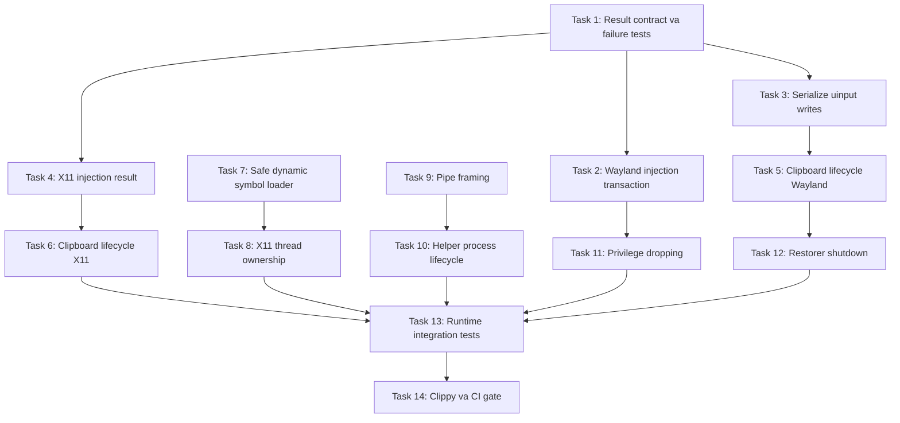

# Ke hoach sua loi: Hardening input injection va clipboard

## 1. Muc tieu

Sua cac loi correctness, concurrency, FFI, clipboard va process lifecycle duoc phat hien trong audit, theo thu tu uu tien ngan mat input va mat du lieu nguoi dung truoc.

Tieu chi hoan thanh tong the:

- Khong bao `Success` khi thao tac inject that bai.
- Khong xoa input neu khong co duong chen replacement dang tin cay.
- Khong co `unsafe impl Send/Sync` neu invariant thread-safety chua duoc chung minh.
- Khong goi function pointer null tu `dlsym`.
- Khong ghi de clipboard moi cua nguoi dung.
- Khong lam mat partial record tren pipe nonblocking.
- Moi child process va background thread deu co timeout va lifecycle ro rang.
- `cargo test --workspace --all-targets` pass.
- `cargo clippy --workspace --all-targets --all-features -- -D warnings` pass.
- Co runtime verification tren X11 va Wayland cho cac flow injection chinh.

## 2. Nguyen tac trien khai

1. Sua tung nhom loi nho, moi nhom co regression test rieng.
2. Khong gom refactor rong voi thay doi behavior.
3. Moi task phai de workspace build va test duoc.
4. Cac duong loi phai tra ket qua that, khong silent fallback thanh cong.
5. Cac thao tac delete va insert phai duoc xem la mot transaction.
6. External process phai co timeout, kiem tra exit status va cleanup.
7. Unsafe boundary phai co invariant duoc viet ro va kiem chung bang test hoac synchronization.

## 3. Thu tu phu thuoc



## 4. Phase 1: Chan data loss va failure reporting

### Task 1: Chot contract cho `InjectResult`

**Mo ta:** Xac dinh cach bieu dien thanh cong, loi co the retry va loi khong the recovery trong `KeyInjector`. Bo sung test doubles de ep cac backend that bai tai tung buoc.

**Acceptance criteria:**

- Tat ca API injection co the phan biet thanh cong va that bai.
- Caller khong bo qua failure cua replacement.
- Test chung minh failure duoc propagate tu backend den control flow cua daemon.
- Khong can mot compositor that de test failure propagation.

**Verification:**

```bash
cargo test -p vietc-protocol
cargo test -p vietc-daemon
```

**Files du kien:**

- `protocol/src/inject.rs`
- `protocol/src/uinput_monitor.rs`
- `protocol/src/x11_inject.rs`
- Test module lien quan trong `protocol`

**Scope:** Medium

### Task 2: Bien Wayland replacement thanh transaction co ket qua that

**Mo ta:** Sua `inject_replacement_atomic` de khong tra `Success` khi `wtype` va clipboard fallback deu fail. Tach strategy selection khoi side effect de test duoc. Delete chi duoc thuc hien khi insertion strategy da san sang, hoac failure sau delete phai duoc bao ve de caller recovery.

**Acceptance criteria:**

- `wtype` fail va clipboard fail tra failure.
- `wtype` fail nhung clipboard thanh cong tra success.
- Empty replacement va ASCII fast path giu behavior cu.
- Khong log noi dung input day du trong log production.
- Shift-prefix duoc dong goi thanh strategy co test va co the tat neu runtime khong ho tro.

**Verification:**

```bash
cargo test -p vietc-protocol uinput
cargo test -p vietc-daemon
```

**Files du kien:**

- `protocol/src/uinput_monitor.rs`
- Test module moi hoac hien co cua `vietc-protocol`

**Scope:** Medium

### Task 3: Serialize va kiem tra day du raw uinput writes

**Mo ta:** Chuyen cac raw `libc::write` thanh mot helper tra `Result`, xu ly `EINTR`, short write va serialize toan bo key transaction. Xem lai nhu cau cua `unsafe impl Send/Sync`.

**Acceptance criteria:**

- Moi `input_event` duoc ghi day du hoac tra loi.
- Press, release va sync cua mot transaction khong bi interleave.
- Khong con bo qua return value cua `libc::write`.
- Xoa `unsafe impl Sync` neu caller khong thuc su can share; neu can, invariant phai duoc bao ve bang mutex.
- Co test cho short write, interrupted write va concurrent transactions bang writer abstraction.

**Verification:**

```bash
cargo test -p vietc-protocol uinput
cargo clippy -p vietc-protocol --all-targets --all-features -- -D warnings
```

**Files du kien:**

- `protocol/src/uinput_monitor.rs`
- Test module cua `vietc-protocol`

**Scope:** Medium

### Task 4: Lam ket qua X11 clipboard paste trung thuc

**Mo ta:** `paste_via_clipboard` chi tra thanh cong khi mot supported selection request da duoc phuc vu trong deadline. Propagate failure qua `send_string` va `inject_replacement`.

**Acceptance criteria:**

- Timeout ma khong co `SelectionRequest` tra failure.
- Unsupported target khong duoc tinh la paste thanh cong.
- `inject_replacement` khong silent success sau khi da backspace.
- Deadline la constant co ten va test duoc.
- Target-supported va timeout paths co regression tests.

**Verification:**

```bash
cargo test -p vietc-protocol x11
```

**Files du kien:**

- `protocol/src/x11_inject.rs`
- Test module cua `vietc-protocol`

**Scope:** Medium

## Checkpoint 1

```bash
cargo test --workspace --all-targets
cargo check --workspace --all-targets --all-features
```

Dieu kien qua checkpoint:

- Khong con duong confirmed nao xoa text, insert fail roi bao success.
- Failure propagation co test.
- Uinput transaction khong interleave.

## 5. Phase 2: Clipboard correctness

### Task 5: Sua lifecycle clipboard theo tung Wayland injection burst

**Mo ta:** Thay `clipboard_saved` toan lifecycle bang session/burst state. Moi burst snapshot clipboard hien tai; khi restore xong thi reset state. Truoc restore phai xac minh clipboard van la gia tri Vietc da ghi.

**Acceptance criteria:**

- Sau khi restore A, neu user copy B thi burst sau snapshot B.
- Restorer khong ghi de B neu clipboard da thay doi ngoai Vietc.
- State duoc reset sau restore, cancel va shutdown.
- External clipboard command khong chay trong khi giu mutex.
- Co test cho chuoi A, inject, restore, user copy B, inject, restore B.

**Verification:**

```bash
cargo test -p vietc-protocol clipboard
```

**Files du kien:**

- `protocol/src/uinput_monitor.rs`
- Test module cua `vietc-protocol`

**Scope:** Medium

### Task 6: Bao toan clipboard tren X11

**Mo ta:** Tao clipboard preservation abstraction cho X11. Snapshot gia tri truoc khi chiem selection, chi restore neu Vietc van dang so huu gia tri injected va khong ghi de thay doi moi cua user.

**Acceptance criteria:**

- Non-ASCII injection khong lam mat clipboard truoc do.
- Clipboard user thay doi trong luc injection khong bi restore de len.
- Shutdown khong lam clipboard mat du lieu.
- X11 va Wayland dung chung state model neu phu hop, khong copy logic gan giong nhau.

**Verification:**

```bash
cargo test -p vietc-protocol x11_clipboard
```

Manual check:

- Copy mot chuoi, go tieng Viet tren X11, paste lai va xac nhan chuoi cu con nguyen.
- Lap lai trong luc copy mot gia tri moi truoc deadline restore.

**Files du kien:**

- `protocol/src/x11_inject.rs`
- Co the them `protocol/src/clipboard_state.rs`
- Test module cua `vietc-protocol`

**Scope:** Medium

## 6. Phase 3: FFI va thread safety

### Task 7: Tao dynamic symbol loader an toan

**Mo ta:** Thay macro transmute truc tiep bang helper resolve symbol co null check, typed conversion va cleanup tren moi failure path.

**Acceptance criteria:**

- Moi symbol thieu tra initialization error co ten symbol.
- Khong transmute null pointer.
- Handle da mo duoc dong khi symbol resolution fail.
- Dung C string API phu hop, khong tao nul-terminated string thu cong.
- Co test voi shared library fixture thieu symbol.

**Verification:**

```bash
cargo test -p vietc-protocol symbol
cargo clippy -p vietc-protocol --all-targets --all-features -- -D warnings
```

**Files du kien:**

- `protocol/src/x11_inject.rs`
- `protocol/src/x11_capture.rs`
- Co the them `protocol/src/dylib.rs`
- Test fixture cua `vietc-protocol`

**Scope:** Medium

### Task 8: Loai bo `X11Injector` Sync khong an toan

**Mo ta:** Chon mot owner model ro rang. Uu tien dedicated injection thread nhan command qua channel; neu kien truc hien tai khong can share, bo `Sync` va giu injector tren mot thread.

**Acceptance criteria:**

- Khong con `unsafe impl Sync for X11Injector`.
- `RefCell`, `Cell` va Xlib `Display` khong bi truy cap dong thoi.
- Tat ca operation lien quan den cung mot `Display` chay tren cung owner thread hoac cung mutex.
- Shutdown owner thread co join.
- Co concurrency test hoac compile-time ownership proof.

**Verification:**

```bash
cargo test -p vietc-protocol x11
cargo test -p vietc-daemon
```

**Files du kien:**

- `protocol/src/x11_inject.rs`
- `daemon/src/inject.rs`
- Test module lien quan

**Scope:** Medium

## Checkpoint 2

```bash
cargo test --workspace --all-targets
cargo clippy -p vietc-protocol --all-targets --all-features -- -D warnings
```

Dieu kien qua checkpoint:

- Khong con unchecked `dlsym`.
- Khong con unsafe `Sync` tren interior-mutability state.
- Clipboard X11 va Wayland deu co ownership-safe restore.

## 7. Phase 4: Capture pipe va child lifecycle

### Task 9: Giu partial pipe frame qua nhieu lan doc

**Mo ta:** Them persistent receive buffer vao `X11Capture`. `drain_pipe` chi parse frame day du 8 byte va giu remainder cho lan goi sau.

**Acceptance criteria:**

- Split frame 1+7, 3+5 va 7+1 byte deu parse dung mot event.
- Nhieu frame va remainder trong mot read duoc xu ly dung.
- EOF voi partial frame duoc bao loi ro rang, khong silently desync.
- Khong dung packed field reference gay unaligned access.

**Verification:**

```bash
cargo test -p vietc-protocol pipe
```

**Files du kien:**

- `protocol/src/x11_capture.rs`
- Test module cua `vietc-protocol`

**Scope:** Small

### Task 10: Them timeout va cleanup cho `vietc-xrecord`

**Mo ta:** Thay blocking `read_line` bang readiness handshake co deadline. Kiem tra `fcntl`; neu setup fail thi kill va reap child. Restart dung cung mot helper duy nhat voi startup path.

**Acceptance criteria:**

- Helper khong gui newline bi timeout trong thoi gian gioi han.
- Helper exit som duoc report.
- `F_GETFL` hoac `F_SETFL` fail lam initialization fail sach.
- Moi failure path kill va `wait` child.
- Initial startup va restart dung chung implementation.
- `Drop` khong de zombie process.

**Verification:**

```bash
cargo test -p vietc-protocol xrecord
```

**Files du kien:**

- `protocol/src/x11_capture.rs`
- Test helper/fixture cua `vietc-protocol`

**Scope:** Medium

## 8. Phase 5: Privilege va shutdown hardening

### Task 11: Ha privilege day du khi spawn desktop commands

**Mo ta:** Tao mot command builder duy nhat cho process root chay command trong desktop session cua user. Clear/init supplementary groups, set GID truoc UID, validate display/runtime paths va dung environment allowlist.

**Acceptance criteria:**

- Child khong giu supplementary groups cua root.
- GID duoc set truoc UID.
- `XDG_RUNTIME_DIR`, `DISPLAY`, `WAYLAND_DISPLAY`, `XAUTHORITY` duoc lay tu nguon tin cay va validate.
- Missing session identity tra failure thay vi fallback chay root.
- Co test kiem tra command preparation; privileged behavior co integration test rieng.

**Verification:**

```bash
cargo test -p vietc-protocol privilege
cargo test -p vietc-daemon
```

**Files du kien:**

- `protocol/src/uinput_monitor.rs`
- Co the them `protocol/src/user_command.rs`
- Test module cua `vietc-protocol`

**Scope:** Medium

### Task 12: Quan ly restorer thread co ownership va join

**Mo ta:** Luu `JoinHandle`, gui shutdown, wake condvar va join trong `Drop`. External clipboard I/O chay ngoai mutex voi state reconciliation sau I/O.

**Acceptance criteria:**

- Drop doi restorer ket thuc.
- Khong restore clipboard sau khi Drop hoan tat.
- Khong giu mutex trong luc cho child process.
- Khoi tao injector moi khong race voi restorer cu.
- Test dung fake clipboard backend chung minh shutdown deterministic.

**Verification:**

```bash
cargo test -p vietc-protocol restorer
```

**Files du kien:**

- `protocol/src/uinput_monitor.rs`
- Test module cua `vietc-protocol`

**Scope:** Medium

## Checkpoint 3

```bash
cargo test --workspace --all-targets
cargo check --workspace --all-targets --all-features
```

Dieu kien qua checkpoint:

- Khong con detached background worker.
- Khong con helper startup co the block vo han.
- Desktop child process duoc drop privilege day du.

## 9. Phase 6: Runtime proof va quality gate

### Task 13: Them integration harness cho X11 va Wayland

**Mo ta:** Xay test harness co the chay trong VM/session that, tap trung vao observable behavior thay vi implementation detail.

**Scenario bat buoc:**

1. Wayland: `wtype` thanh cong.
2. Wayland: `wtype` fail, clipboard fallback thanh cong.
3. Wayland: ca hai fail, result la failure va khong silent data loss.
4. Chromium Wayland: Shift-prefix khong de stuck modifier.
5. Chromium Wayland: user dang giu Shift trong luc inject.
6. X11: supported SelectionRequest thanh cong.
7. X11: khong co SelectionRequest thi timeout va failure.
8. X11/Wayland: clipboard cu duoc bao toan.
9. Clipboard thay doi boi user trong luc debounce khong bi ghi de.
10. XRecord helper hang, exit som va partial pipe frames.
11. Repeated Vietnamese replacements khong duplicate hoac drop ky tu.
12. Shutdown va restart daemon khong de child/thread song sot.

**Acceptance criteria:**

- Moi scenario co pass/fail assertion ro rang.
- Test timeout bi gioi han, khong the hang CI vo han.
- Runtime artifact ghi ro display server, compositor, tool versions va failure logs.
- Test can `/dev/uinput` duoc danh dau de chay trong privileged integration job, khong gia vo la unit test.

**Verification:**

```bash
cargo test --workspace --all-targets
cargo test -p vietc-daemon --test daemon_suite -- --test-threads=1
```

Manual matrix toi thieu:

- X11.
- GNOME Wayland.
- KDE Wayland.
- Chromium/Electron app.
- GTK app.
- Qt app.
- Terminal.

**Files du kien:**

- `daemon/tests/daemon_suite.rs`
- `daemon/tests/common/`
- `protocol` test fixtures
- `scripts/setup-test-vm.sh`
- `docs/testing-dictionary.md`

**Scope:** Medium, nen tach thanh nhieu commit theo display backend

### Task 14: Don Clippy va bat CI quality gate

**Mo ta:** Sau khi correctness fixes on dinh, xu ly tat ca warning Clippy con lai va bat quality gate. Khong tron mechanical cleanup vao cac commit behavior truoc do.

**Acceptance criteria:**

- Workspace test pass.
- Workspace Clippy voi `-D warnings` pass.
- Format check pass.
- CI chay cac gate nay tren moi PR.
- Runtime integration tests nhay cam moi truong nam o job rieng va co timeout.
- Khong `allow` lint chi de che unsafe/problematic code neu co cach sua ro rang.

**Verification:**

```bash
cargo fmt --all -- --check
cargo test --workspace --all-targets
cargo clippy --workspace --all-targets --all-features -- -D warnings
```

**Files du kien:**

- Cac file Rust dang co lint warning
- `.github/workflows/` neu da co CI
- Tai lieu contributor neu can

**Scope:** Medium

## 10. Chien luoc commit

Moi task nen la mot commit doc lap:

1. `test: cover injection failure propagation`
2. `fix: propagate Wayland replacement failures`
3. `fix: serialize and validate uinput writes`
4. `fix: report X11 paste failures`
5. `fix: preserve clipboard per injection burst`
6. `fix: preserve X11 clipboard ownership`
7. `fix: validate dynamically loaded X11 symbols`
8. `fix: confine X11 injection to one thread`
9. `fix: retain partial XRecord pipe frames`
10. `fix: bound XRecord helper startup`
11. `fix: fully drop privileges for desktop commands`
12. `fix: join clipboard restorer on shutdown`
13. `test: add display backend integration coverage`
14. `ci: enforce workspace quality gates`

Khong commit generated artifacts trong `target/`.

## 11. Rui ro va mitigation

### Rui ro: Thay doi `InjectResult` lan sang nhieu caller

Mitigation: Them test contract truoc, compile tung package, giu API migration trong mot task rieng.

### Rui ro: Clipboard protocol khac nhau giua X11 va Wayland

Mitigation: Dung chung state machine, nhung giu backend I/O tach biet. Khong ep hai protocol vao mot implementation gia lap.

### Rui ro: X11 owner-thread refactor anh huong latency

Mitigation: Dung bounded channel, benchmark end-to-end key replacement, khong toi uu truoc khi co so lieu.

### Rui ro: Runtime test flaky do compositor timing

Mitigation: Cho event-based readiness, deadline ro rang va log artifact; tranh sleep co dinh neu co the quan sat state.

### Rui ro: Shift-prefix phu thuoc phien ban `wtype`

Mitigation: Ghi nhan version, test capability luc startup va co strategy fallback ro rang.

### Rui ro: Privileged tests khong phu hop job CI thuong

Mitigation: Tach unit tests fake backend va privileged VM integration job. Ca hai deu bat buoc truoc release.

## 12. Definition of done

Release chi duoc mo khoa khi:

- Tat ca Critical va High findings da duoc sua hoac co tai lieu chap nhan trade-off ro rang.
- Khong con silent success sau failed injection.
- Khong con unchecked FFI symbol.
- Khong con unsound `Sync`.
- Clipboard preservation pass tren X11 va Wayland.
- Partial pipe va process timeout tests pass.
- Workspace tests, format va Clippy pass.
- Runtime matrix pass tren it nhat mot X11 va hai Wayland compositor, bao gom Chromium/Electron.
- Khong co regression ve Vietnamese composition, duplicate key, missing key hoac stuck modifier.