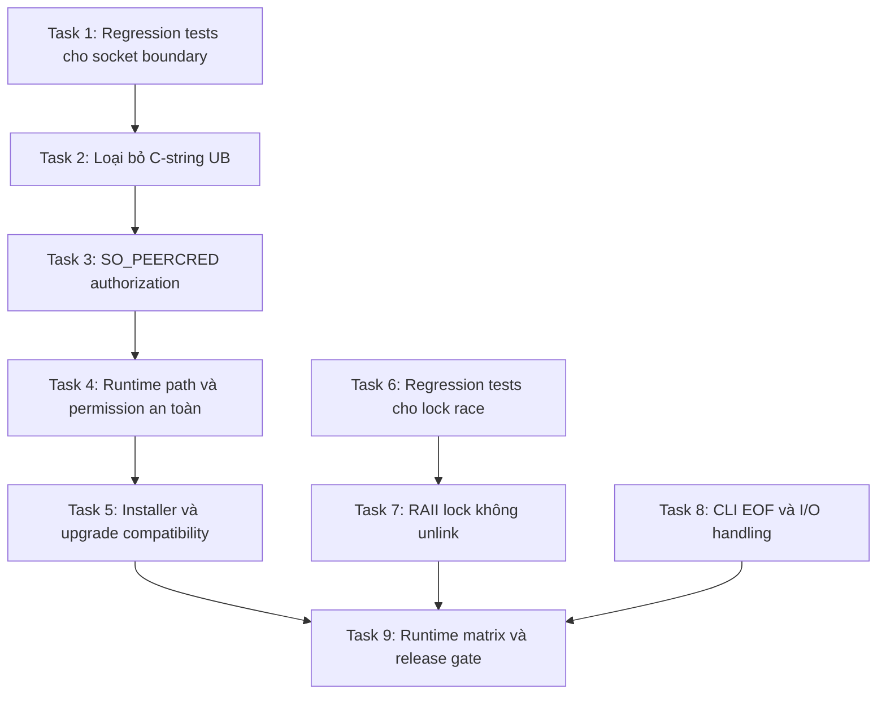

# Kế hoạch sửa lỗi audit: uinputd, single-instance lock và CLI

## 1. Mục tiêu

Khắc phục bốn phát hiện còn lại theo hướng giảm tối đa hồi quy:

1. Loại bỏ việc truyền chuỗi Rust không kết thúc bằng NUL vào `libc::chown` và `libc::chmod`.
2. Ngăn client không được phép điều khiển thiết bị uinput đặc quyền.
3. Loại bỏ race condition có thể cho phép hai daemon cùng chạy.
4. Không để CLI panic khi stdin hoặc stdout đóng.

## 2. Nguyên tắc an toàn

- Mỗi task là một commit độc lập, có regression test và có thể rollback riêng.
- Không refactor các module lớn trong cùng đợt sửa này.
- Giữ nguyên protocol `PING`, `FLUSH`, `QUIT`, `REPLACE`, `BACKSPACE`, `TYPE`, `PASTE`.
- Không đổi permission socket trước khi cơ chế xác thực peer và đường nâng cấp đã được kiểm chứng.
- Không triển khai group hệ thống mới trong bước đầu vì thay đổi installer, quyền user và upgrade path có nguy cơ làm mất chức năng gõ.
- Kernel lock là nguồn sự thật; PID trong file chỉ phục vụ chẩn đoán.
- Mỗi checkpoint phải qua test, Clippy và format trước khi chuyển phase.
- Nếu runtime test input injection thất bại, rollback commit gần nhất thay vì thêm fallback bỏ qua bảo mật.

## 3. Quyết định kiến trúc

### 3.1 Socket uinput

Phương án an toàn nhất cho bản vá đầu tiên:

- Bind socket trong thư mục runtime thuộc user mục tiêu, ưu tiên `$XDG_RUNTIME_DIR/vietc`.
- Socket mode `0600`.
- `uinputd` nhận UID được phép từ cấu hình khởi động hoặc thông tin owner đã xác định rõ.
- Mỗi connection được kiểm tra bằng `SO_PEERCRED` trước khi đọc lệnh.
- Chỉ cho phép đúng UID mục tiêu; root chỉ được cho phép nếu có yêu cầu vận hành đã ghi rõ.
- Không dựa riêng vào mode file vì descriptor có thể được truyền giữa process.
- Không tạo group `vietc` và socket `0660` trong bản vá đầu tiên. Đây là phương án mở rộng sau khi có nhu cầu multi-user thực tế.

Nếu kiến trúc cài đặt hiện tại không cung cấp chắc chắn UID mục tiêu, triển khai migration hai bước:

1. Thêm peer authorization và telemetry lỗi kết nối trong khi tạm giữ compatibility permission.
2. Sau khi installer truyền đúng UID và runtime tests pass, chuyển socket sang `0600`.

Không được phát hành trạng thái trung gian vẫn `0666` mà không có `SO_PEERCRED`.

### 3.2 Filesystem và FFI

- Dùng API Rust an toàn (`std::fs::set_permissions` với `PermissionsExt`) cho mode.
- Tránh `libc::chmod` hoàn toàn.
- Nếu cần `chown`, tạo `CString` từ `OsStrExt::as_bytes`, xử lý `NulError`, gọi sau khi socket tồn tại và kiểm tra errno.
- Xác minh thư mục socket không phải symlink không tin cậy.
- Chỉ xóa stale socket nếu metadata xác nhận đó là Unix socket do runtime path dự kiến quản lý.

### 3.3 Single-instance lock

- Mở lock file một lần, lấy `flock(LOCK_EX | LOCK_NB)` một lần.
- Nếu nhận `EAGAIN` hoặc `EWOULDBLOCK`, đóng fd hiện tại và thoát với thông báo “đã chạy”.
- Không unlink, reopen hoặc retry lock trên inode mới.
- Giữ fd thành công sống suốt vòng đời process bằng guard RAII thay vì dựa vào việc cố tình leak descriptor.
- Ghi PID bằng chính fd đã lock, dùng `ftruncate`, `lseek` và write đầy đủ để tránh thao tác pathname sang inode khác.
- PID và `/proc/<pid>/comm` chỉ dùng để hiển thị chẩn đoán, không quyết định phá lock.

### 3.4 CLI

- `main` trả `io::Result<()>` hoặc gọi một hàm `run() -> io::Result<()>`.
- `flush` propagate lỗi.
- `read_line == 0` được xem là EOF và thoát sạch.
- Broken pipe không tạo panic hoặc backtrace.

## 4. Dependency graph



## 5. Phase 0: Baseline và test seam

### Task 1: Tạo test seam cho socket authorization

**Mô tả:** Tách phần thiết lập listener, đọc peer credentials và dispatch command khỏi `main` để kiểm thử bằng Unix socket thật mà không cần thiết bị `/dev/uinput`.

**Acceptance criteria:**

- Command parser và authorization được test mà không phát key event thật.
- Client UID hợp lệ đi đến dispatcher.
- Client UID không hợp lệ bị đóng trước khi command được thực thi.
- Protocol hiện tại không đổi.

**Verification:**

```bash
cargo test -p vietc-uinputd
cargo check -p vietc-uinputd --all-targets
```

**Dependencies:** Không.

**Files dự kiến:**

- `uinputd/src/main.rs`
- Có thể thêm `uinputd/src/server.rs`
- Test module trong crate `uinputd`

**Scope:** Medium, tối đa 3 file.

### Checkpoint 0

- Test cũ vẫn pass.
- Test không yêu cầu root hoặc `/dev/uinput`.
- Không thay đổi runtime behavior ở checkpoint này.

## 6. Phase 1: Loại bỏ undefined behavior trước

### Task 2: Thay C path handling bằng API an toàn

**Mô tả:** Loại bỏ `String::as_ptr()` khỏi `chown` và `chmod`; đặt permission sau khi bind; không bỏ qua lỗi filesystem quan trọng.

**Acceptance criteria:**

- Không còn truyền pointer không NUL-terminated vào libc path API.
- Không còn gọi `chown` trước khi socket tồn tại.
- Permission được đặt bằng `std::fs::set_permissions`.
- Lỗi tạo thư mục, bind, permission hoặc ownership làm startup fail rõ ràng.
- Startup failure dọn socket do chính lần startup đó tạo.

**Verification:**

```bash
cargo test -p vietc-uinputd
cargo clippy -p vietc-uinputd --all-targets -- -D warnings
cargo fmt --all -- --check
```

**Dependencies:** Task 1.

**Files dự kiến:**

- `uinputd/src/main.rs`
- Test module liên quan

**Scope:** Small.

### Checkpoint 1

- Test startup với path hợp lệ pass.
- Test permission failure trả lỗi, không tiếp tục chạy ở trạng thái nửa cấu hình.
- Không đổi UID authorization hoặc protocol.

## 7. Phase 2: Authorization không làm mất chức năng

### Task 3: Xác thực từng connection bằng `SO_PEERCRED`

**Mô tả:** Lấy `pid`, `uid`, `gid` từ Unix peer credentials ngay sau `accept`; từ chối trước khi tạo `BufReader` hoặc dispatch command nếu UID không đúng policy.

**Acceptance criteria:**

- Peer hợp lệ vẫn chạy đủ `PING`, `TYPE`, `PASTE`, `BACKSPACE`, `REPLACE`.
- Peer không hợp lệ không gây bất kỳ input event nào.
- Lỗi lấy credentials được xử lý fail-closed.
- Log chỉ chứa UID/PID và loại lỗi, không log nội dung người dùng gõ.
- Không có fallback “không lấy được credentials thì cho phép”.

**Verification:**

```bash
cargo test -p vietc-uinputd peer
cargo test -p vietc-protocol uinput_client
cargo clippy -p vietc-uinputd --all-targets -- -D warnings
```

**Dependencies:** Task 2.

**Files dự kiến:**

- `uinputd/src/main.rs` hoặc `uinputd/src/server.rs`
- `protocol/src/uinput_client.rs`
- Tests liên quan

**Scope:** Medium.

### Task 4: Chuyển socket sang runtime directory riêng và mode `0600`

**Mô tả:** Thay socket world-writable bằng runtime directory thuộc user được cấp quyền. Không fallback im lặng về `/tmp`.

**Acceptance criteria:**

- Socket không còn mode `0666`.
- Runtime directory mode `0700`; socket mode `0600`.
- Owner khớp UID mà authorization policy cho phép.
- Nếu không xác định được runtime directory hoặc UID mục tiêu, service fail với hướng dẫn sửa cấu hình.
- Không unlink file thường hoặc symlink tại socket path.
- Restart dọn đúng stale Unix socket nhưng không xóa filesystem object ngoài control.

**Verification:**

```bash
cargo test -p vietc-uinputd socket_path
cargo test -p vietc-uinputd socket_permissions
cargo test -p vietc-uinputd stale_socket
```

Manual check:

```bash
stat -c '%a %u %g %F' "$XDG_RUNTIME_DIR/vietc/uinput.sock"
```

Kỳ vọng: directory `700`, socket `600`, đúng UID.

**Dependencies:** Task 3.

**Files dự kiến:**

- `uinputd/src/main.rs` hoặc `uinputd/src/server.rs`
- Service/install configuration phù hợp
- Tests liên quan

**Scope:** Medium.

### Task 5: Bảo đảm fresh install và upgrade không khóa client hợp lệ

**Mô tả:** Cập nhật installer/service để truyền UID/runtime path nhất quán, xử lý cả cài mới và nâng cấp từ socket `~/.vietc/uinput.sock`.

**Acceptance criteria:**

- Fresh install tạo service với UID authorization đúng.
- Upgrade xóa hoặc vô hiệu hóa socket cũ `0666` một cách có kiểm tra.
- Không yêu cầu user tự sửa permission sau upgrade.
- Uninstall chỉ xóa artifact Vietc quản lý.
- Nếu user chưa logout/restart, installer thông báo rõ bước cần thực hiện.
- Rootless path hiện tại không bị thay đổi nếu không dùng fallback uinputd.

**Verification:**

- Chạy installer trong test VM cho fresh install.
- Chạy installer trên fixture mô phỏng bản cũ có socket `0666`.
- Restart service hai lần liên tiếp.
- Client hợp lệ gửi `PING` nhận `PONG`.
- Client UID khác bị từ chối.
- Rootless/X11 mode vẫn khởi động bình thường.

**Dependencies:** Task 4.

**Files dự kiến:**

- `install.sh`
- `uninstall.sh`
- File service liên quan
- Test/VM script liên quan

**Scope:** Medium. Nếu vượt 5 file, tách installer và uninstall thành hai commit.

### Checkpoint 2: Gate bảo mật và compatibility

```bash
cargo test --workspace --all-targets
cargo clippy --workspace --all-targets --all-features -- -D warnings
cargo fmt --all -- --check
```

Bắt buộc kiểm tra runtime:

- Client hợp lệ vẫn gõ ASCII và Unicode.
- `REPLACE` xóa và chèn đúng.
- Client không hợp lệ không thể phát input.
- Socket không world-writable.
- Restart không để stale socket.
- Fresh install và upgrade đều dùng được.

Không qua checkpoint nếu chỉ unit test pass nhưng input injection thực tế fail.

## 8. Phase 3: Single-instance lock

### Task 6: Thêm regression test tái hiện split-inode lock

**Mô tả:** Tạo process-level test khởi động holder và contender trên cùng lock path; PID text được làm stale/non-matching trong khi holder vẫn giữ kernel lock.

**Acceptance criteria:**

- Test cũ phải tái hiện khả năng contender lấy lock inode mới sau unlink.
- Test có timeout, dọn child process và file tạm.
- Không phụ thuộc PID cụ thể hoặc timing sleep dài.
- Test chạy ổn định nhiều lần.

**Verification:**

```bash
cargo test -p vietc-daemon single_instance -- --nocapture
```

**Dependencies:** Không phụ thuộc phase socket, nhưng nên thực hiện tuần tự để giảm thay đổi đồng thời.

**Files dự kiến:**

- `daemon/src/signal.rs`
- Test module hoặc integration test daemon

**Scope:** Small.

### Task 7: Thay lock logic bằng RAII guard, tuyệt đối không unlink khi contention

**Mô tả:** `ensure_single_instance` trả guard giữ fd. Khi `flock` báo contention, process thoát; không đọc PID để quyết định phá lock.

**Acceptance criteria:**

- Chỉ một process lấy lock trong mọi test contention.
- Không có `remove_file` hoặc reopen path sau `EAGAIN`/`EWOULDBLOCK`.
- FD được giữ sống bằng type rõ ràng và đóng khi guard drop.
- PID được ghi qua locked fd, không phải `std::fs::write(path, ...)`.
- Lỗi lock khác contention trả exit failure thay vì exit success.
- Message phân biệt “đã có instance” với “không thể kiểm tra lock”.

**Verification:**

```bash
cargo test -p vietc-daemon single_instance
cargo clippy -p vietc-daemon --all-targets --all-features -- -D warnings
```

Manual check:

- Khởi động hai instance gần như đồng thời.
- Xác nhận chỉ một process tiếp tục.
- Kill instance giữ lock rồi xác nhận instance mới khởi động được ngay.

**Dependencies:** Task 6.

**Files dự kiến:**

- `daemon/src/signal.rs`
- Call sites nhận và giữ guard
- Tests liên quan

**Scope:** Medium.

### Checkpoint 3

- Chạy regression test contention ít nhất 50 lần trong CI hoặc loop test có timeout.
- Không có hai instance cùng vào runtime loop.
- Shutdown bình thường thả lock.
- SIGKILL cũng thả kernel lock khi process kết thúc.

## 9. Phase 4: CLI graceful I/O

### Task 8: Xử lý EOF và broken pipe không panic

**Mô tả:** Chuyển CLI loop sang `io::Result`, kiểm tra số byte đọc và thoát sạch trên EOF.

**Acceptance criteria:**

- `printf '' | vietc-cli` thoát sạch, không loop và không panic.
- Broken stdout pipe không tạo backtrace.
- Luồng interactive và lệnh `quit` giữ nguyên.
- Không nuốt lỗi I/O bất thường; lỗi được báo ngắn gọn và exit code khác 0 khi phù hợp.

**Verification:**

```bash
cargo test -p vietc-cli
printf '' | cargo run -q -p vietc-cli
printf 'quit\n' | cargo run -q -p vietc-cli
```

**Dependencies:** Không.

**Files dự kiến:**

- `cli/src/main.rs`
- CLI integration test nếu crate chưa có

**Scope:** Small.

## 10. Phase 5: Runtime matrix và release gate

### Task 9: Chạy verification matrix

**Automated gate:**

```bash
cargo fmt --all -- --check
cargo test --workspace --all-targets
cargo clippy --workspace --all-targets --all-features -- -D warnings
cargo audit
```

**Runtime matrix bắt buộc:**

| Scenario | Kết quả yêu cầu |
|---|---|
| Rootless X11/XWayland | Gõ và replacement như baseline |
| Wayland fallback uinputd | ASCII, Unicode và replacement pass |
| Fresh install | Client hợp lệ kết nối ngay |
| Upgrade từ bản socket `0666` | Socket cũ bị loại bỏ an toàn; client mới kết nối |
| Service restart | Không stale socket, không mất quyền |
| Client UID khác | Bị từ chối, không phát input |
| Hai daemon đồng thời | Chỉ một instance chạy |
| CLI stdin EOF | Thoát sạch |
| CLI broken pipe | Không panic |
| Shutdown/restart lặp lại | Không leak child, thread, socket hoặc lock |

## 11. Rollout an toàn

1. Phát hành bản thử nghiệm cho fallback uinputd trước, không đổi rootless path.
2. Ghi nhận lỗi authorization theo UID/PID nhưng tuyệt đối không log text input.
3. Chuẩn bị rollback package giữ binary cũ nhưng không khôi phục socket `0666`; nếu cần rollback, service phải dừng thay vì mở lại lỗ hổng.
4. Chỉ phát hành stable khi fresh install và upgrade đều pass trên ít nhất một máy X11/XWayland và một máy Wayland fallback.
5. Không gộp refactor các file trên 1.000 dòng vào release bảo mật này.

## 12. Rủi ro và giảm thiểu

| Rủi ro | Mức | Giảm thiểu |
|---|---|---|
| Xác định sai UID làm client hợp lệ bị từ chối | Cao | Installer truyền UID rõ ràng; test fresh install/upgrade; fail rõ thay vì fallback |
| Đổi socket path làm client tìm sai vị trí | Cao | Một hàm canonical tạo path dùng chung client/server; migration test |
| Permission chặt làm mất chức năng sau upgrade | Cao | Peer-auth trước, permission sau; checkpoint runtime bắt buộc |
| Xóa nhầm file tại socket path | Cao | `symlink_metadata`, chỉ unlink Unix socket trong runtime dir được quản lý |
| Lock guard bị drop quá sớm | Cao | Trả guard và giữ trong biến sống bằng vòng đời daemon; process-level test |
| Test uinput cần quyền root gây flaky CI | Trung bình | Unit test server bằng socket thật và fake dispatcher; runtime test trong VM/job riêng |
| Thay đổi installer ảnh hưởng rootless mode | Trung bình | Branch logic theo mode; smoke test rootless không khởi động uinputd |
| Refactor lớn che giấu regression | Trung bình | Không refactor ngoài vùng sửa; mỗi task một commit |

## 13. Definition of Done

- Không còn socket uinput world-writable.
- Mỗi connection được xác thực fail-closed bằng peer credentials.
- Không còn truyền `String::as_ptr()` vào libc path API.
- Không unlink/reopen single-instance lock khi kernel báo contention.
- CLI không panic khi EOF hoặc broken pipe.
- Tất cả automated gate pass.
- Tất cả runtime matrix bắt buộc pass.
- Fresh install, upgrade, restart và uninstall được kiểm thử.
- Mỗi thay đổi có regression test và commit riêng.
